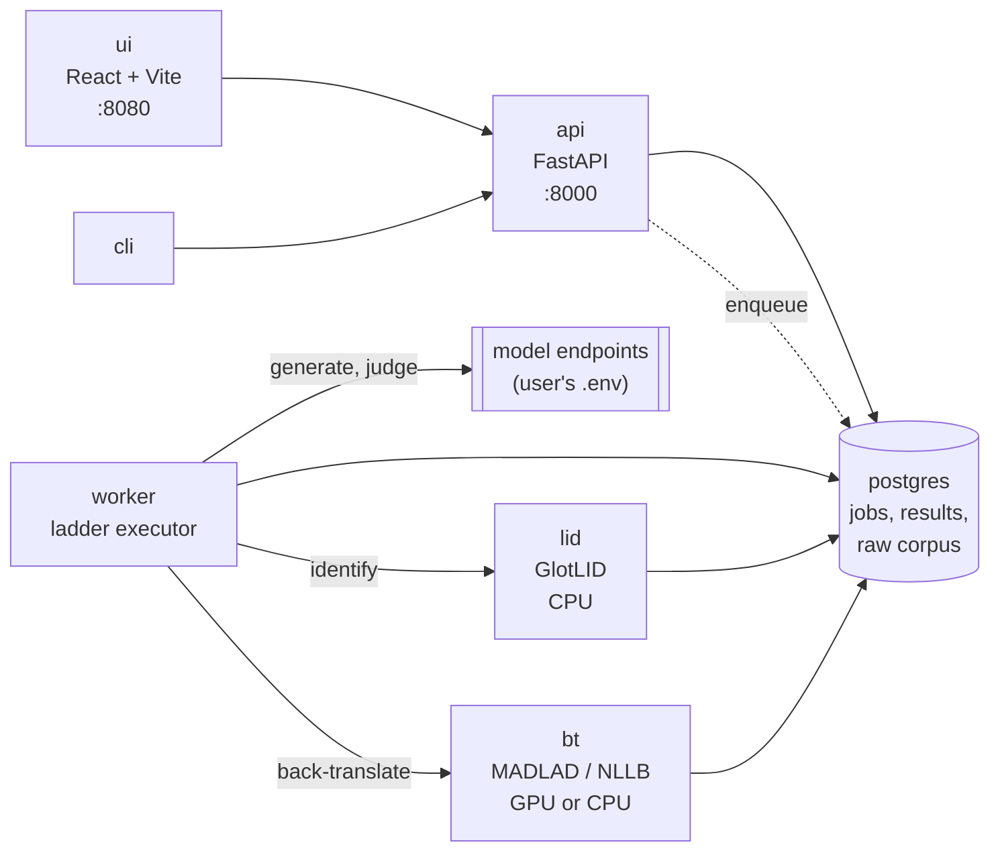
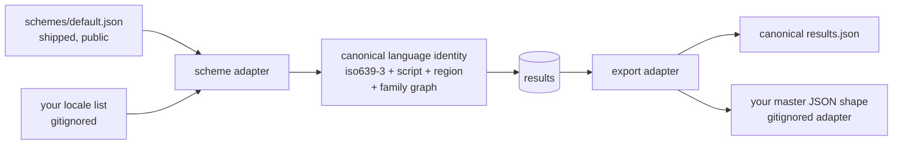

# 03 — Architecture and development stages (Stage 3)

Date: 2026-09-15
Status: proposal for review. No code written yet.
Depends on: `01 - Initial discussion - stage 1.md` (methodology, output contract, dialect logic), `02 - Experiment - invented language control.md`.

---

## Summary

A single-tenant application the user runs themselves: `git clone`, fill `.env`, `docker compose up`, UI on `localhost`. Five services, one database, no hosted infrastructure, no key custody, no multi-tenancy.

The deployment pivot removed most of what made `Basic idea v0.md`'s architecture heavy. There is no queue contention, no abuse surface, no metering, no tenant isolation, and no autoscaling. What remains is a job runner with a GPU-bound component, and the architecture should say so rather than dress it up.

---

## What the pivot deleted

| In `Basic idea v0.md` | Status | Why |
|---|---|---|
| Kafka / RabbitMQ | **dropped** | One user, one job at a time. A Postgres job table with `SELECT … FOR UPDATE SKIP LOCKED` is the whole queue, and it is crash-safe and inspectable. |
| Redis | **dropped from v1** | The cache is the results table, which must be durable anyway. Redis would be a second source of truth for no gain. |
| Nginx / Caddy, HTTPS | **dropped** | localhost. TLS termination solves a problem we no longer have. |
| API-key entry UI, encryption at rest | **dropped** | Keys live in the user's own `.env` and never reach the application's storage. |
| Background queue for public submissions | **dropped** | No public submissions. |

Keeping these would be cargo cult. They can return the day someone genuinely hosts this, and the job table is a clean seam for that.

---

## Services

> **This section is the S0 plan, and three of its five services were never built.** It is kept because the reasoning still explains the shape of the code, and because deleting a plan hides that it changed. **What actually exists is described in *Services as built* below, and that is the section to trust.** Corrected 2026-09-29.

Five containers. The split is justified by **model lifetime and hardware affinity**, not by fashion: the two ML services load large models once and hold them, and exactly one of them wants the GPU.



| Service | Role | Hardware |
|---|---|---|
| `api` | REST: jobs, results, export/merge, scheme browse | CPU, trivial |
| `worker` | Executes the ladder; the only component that knows the method | CPU + network |
| `lid` | GlotLID language+script identification | CPU always, ~1.2 GB RAM |
| `bt` | Back-translation, and back-translator qualification | **GPU if available**, else CPU or remote |
| `ui` | SPA on localhost | — |
| `postgres` | All state, including the raw generation corpus | — |

`worker` calls `lid` and `bt` over HTTP rather than importing them, so the heavy models load once per container rather than once per job, and so a CPU-only machine can swap `bt` for a remote back-translator with no code change.

### Hardware profile detection

Resolved once at `bt` startup, overridable by `HARDWARE_PROFILE` in `.env`, and **recorded on every result**:

| Detected | Profile | Back-translator | Coverage |
|---|---|---|---|
| CUDA, VRAM ≥ 6 GB | `gpu-fp16` | MADLAD-400-3B-MT fp16 | ~400 languages |
| CUDA, VRAM 4–6 GB | `gpu-int8` | MADLAD-400-3B-MT int8 | ~400 languages |
| CUDA, VRAM < 4 GB, or none | `cpu` | NLLB-200-distilled-600M | ~200 languages |
| `BT_REMOTE_MODEL` set | `api` | A configured LLM | as qualified |

Verified reference machine: RTX 4060 Laptop 8 GB, Docker 27.5.1 with the `nvidia` runtime registered, `docker run --gpus all` confirmed working. That machine lands on `gpu-fp16`, marginally — `gpu-int8` is the safer default and should be what the autodetect picks at 8 GB.

`docker compose --profile gpu up` adds the device reservation; the default profile is CPU so that `docker compose up` works everywhere.

---

## Services as built (corrected 2026-09-29)

**One container, and the GPU is not used.**

| Planned | As built | |
|---|---|---|
| `api` | **`api`** — FastAPI, serves the UI and the results API | the only service |
| `ui` | folded into `api` | a single `index.html`, no build step, no second container |
| `worker` | folded into the CLI and `runner.py` | a scan is a process, not a service; `runner.py` is the one definition of one |
| `postgres` | **dropped** for SQLite on a bind mount | single writer, single tenant; supporting both cost two real bugs |
| `lid` | in-process, `probe/lid.py` | GlotLID is CPU-only and loads in about a second; an HTTP hop bought nothing |
| `bt` | **never built** | see below |

### Why there is no local back-translator, and what that cost

The `bt` service — MADLAD-400-3B on the GPU, NLLB-200 on CPU — was scheduled for S3, then deferred to S6, and neither stage recorded that it had not happened. S1 used the remote path as a deliberate stopgap (`bt/remote.py` still says *"the local MADLAD/NLLB back-translator arrives in S3"*), S2 built qualification and per-language routing on top of it, and by S3 the remote panel worked well enough that nobody came back to it. Every result this project has ever produced was back-translated by a remote model.

That is a defensible outcome — the remote panel is qualified per language against human reference text, which is the property that actually matters (protocol 005) — but it was never a decision, and it left three things wrong:

1. **Results claimed an instrument that never ran.** `hardware.detect()` still resolved to `gpu-int8` on the reference machine, and that string was stamped on every result and job row. A row reading `hardware_profile: gpu-int8` asserts MADLAD-400-3B read the text; Gemini read it. The `backtranslator` column held the truth and this field contradicted it — on a field whose entire purpose is to say when two results are comparable (docs/01). `detect()` now separates *what this machine could run* (`capable_of`, still probed, still reported by `/hardware`) from *what actually read the text* (`profile`, which is `api` until `bt/local.py` exists). The detection logic is kept and tested so it can be switched back on by one constant.
2. **The container ran a degraded gate.** `api.Dockerfile` installed the package without extras, and `fasttext` is an optional extra — so inside Docker GlotLID could not load and `probe/lid` fell back to script-only, losing the language half of the gate. Harmless while scans run from the host CLI, which is what we do; not harmless the moment a scan is started from the browser, which the UI offers. The image now installs `.[lid]`.
3. **This document described a system that does not exist**, which S8 would have documented.

### What the GPU would still be for

Not cost. A 200-language scan is single-digit dollars, and back-translation is a third of it.

**Reproducibility.** The S0 comparison table in this document scored API-only as *"Reproducibility: none — vendors change models"*, and that judgement was right. A published dataset whose instrument is a vendor endpoint cannot be re-graded by a reader, and cannot be re-graded by us once the vendor retires the model. A local MADLAD checkpoint is pinnable, and anyone with the raw corpus could reproduce every score.

That is a real argument and it is unfinished business, not a closed question. It is deliberately **not** being acted on mid-programme: results are only comparable within the same back-translator (convention 4), so switching instruments while the cross-engine scans are running would strand everything measured so far. The place to decide it is S8, with the data in hand.

---

## Stack

Chosen for legibility and for being demonstrable in a portfolio, not for novelty.

| Layer | Choice | Note |
|---|---|---|
| Language | Python 3.12 | Same language as the ML components; one toolchain |
| API | FastAPI + Pydantic v2 | Schemas are the contract; OpenAPI docs come free |
| DB | PostgreSQL 16 + SQLAlchemy 2 + Alembic | JSONB for raw payloads, real columns for everything queried |
| Queue | Postgres table, `FOR UPDATE SKIP LOCKED` | Crash-safe, inspectable, no extra service |
| ML | PyTorch + HuggingFace `transformers`; `fasttext` for GlotLID | |
| UI | React + Vite + TypeScript | SPA per the original intent |
| Packaging | docker compose, `cpu` / `gpu` profiles | |
| Tests | pytest, with a recorded-response fixture set | Method changes must be testable without spending tokens |

The recorded-response fixtures matter more than they look: the 204 raw responses already captured in `experiments/results/` are the seed. Grading logic must be re-runnable offline, or every method change costs money and becomes untestable in CI.

---

## Data model

Ten tables. The two that carry the project's long-term value are `generation` (the raw corpus) and `result`.

| Table | Holds | Notes |
|---|---|---|
| `language` | The 602-tag scheme | Loaded from `languages.json`; `link` resolved to both tag keys and `lll` codes |
| `lang_class` | The 423 `(lll, script)` equivalence classes | Probe 3 runs per class, not per tag |
| `engine` | `mt.*` identifiers | Both MT engines and LLMs — one namespace, per the TMS |
| `marker_set` | Per-tag marker lists and elicitation contexts | `status`: `markers` / `not-distinguishable`; absent = `untested` |
| `job` | engine, tag list, method_version, backtranslator, judge, profile, status | Batch is the only mode |
| `job_item` | job × tag × rung × designator | The unit of work |
| `generation` | prompt, designator, raw output, tokens, latency | **Never deleted.** Re-gradable when the method changes |
| `lid_result` | language, script, confidence per generation | Feeds both the gate and `resolves_to` |
| `grade` | per-fact `present` / `missing` / `contradicted`, judge id | Blind; NLI cross-check stored alongside |
| `result` | per (tag, engine, method_version) | The publishable row — see below |
| `bt_qualification` | per (language, back-translator) pass/fail | Gates whether a low score is interpretable at all |

### The `result` row

```json
{
  "tag": "kk-latn",
  "engine": "mt.openai-gpt-4o",
  "tier": "Basic",
  "ci": [0.31, 0.58],
  "borderline": true,
  "evidence": "fact-recall",
  "provenance": "measured",
  "designator": { "winner": "Kazakh (Latin script)", "tried": ["...", "..."] },
  "variant_evidence": "proven",
  "resolves_to": null,
  "scores": { "s_lang": 0.92, "s_content": 0.44, "s_variant": 0.80 },
  "backtranslator": "madlad400-3b-mt@int8",
  "judge": "openai-gpt-4o",
  "hardware_profile": "gpu-int8",
  "method_version": "1.0.0",
  "tested_at": "2026-09-15T12:00:00Z"
}
```

A macrolanguage row carries `resolves_to` as a distribution (`{"kaz_Cyrl": 6, "kaz_Latn": 0}`) and `variant_evidence: null`.

### Export and merge

Two artifacts, as fixed in doc 01:

- `languages_llm_support.<engine>.json` — the master's exact shape, `{ "<key>": { "mt.<engine>": "<designator>" } }`, mergeable.
- `results/<engine>/<method_version>.json` — full evidence, never merged.

Merge is a **per-key, per-engine upsert**. A key absent from run output never means delete. Conflict rule: higher `method_version` wins, then newer `tested_at`. Implemented as a pure function over two JSON documents with its own test suite — it is the one place where a bug silently destroys the TMS's data.

---

## Cost and time per full scan

Per model, 602 tags via 423 classes, on the adaptive ladder:

| Rung | Calls | Judge calls |
|---|---|---|
| 1 — designator sweep, gate-only | 423 × 3 items × ~2.5 designators ≈ 3,200 | 0 |
| 2 — fact recall on survivors | ~230 × 3 ≈ 700 | ~700 |
| 3 — borderline widening | ~80 × 14 ≈ 1,100 | ~1,100 |
| 4 — dialect probes | 239 × 3 ≈ 700 | 0 (script/marker scored locally) |
| **Total** | **≈ 5,700** | **≈ 1,800** |

At roughly 150 output tokens per generation and 100 per judgment, that is ~1.0 M generation + ~0.2 M judge tokens. On a mid-tier model, single-digit dollars; on a frontier model, low tens. Back-translation is local and free on the GPU profile.

Wall clock is dominated by the endpoint, not by us: at 8 concurrent requests and ~1 s per call, roughly 15–20 minutes for a full scan. **Reasoning must be off** — doc 02 measured a 150× token difference and ~25× latency on one route.

### Overspend guards

Single-tenant removes the abuse case but not the accident case:

- `--dry-run` prints the full call plan and an estimate before spending anything.
- A per-job `max_calls` and `max_tokens` budget, enforced in `worker`, job fails closed.
- Every rung is resumable — a killed job restarts from `job_item`, never from zero.
- Results are cached on `(engine, tag, method_version, backtranslator)`; re-running a scan costs nothing for unchanged rows.

---

## Development stages

Each stage ends in something demonstrable. Review between stages.

| # | Stage | Done when |
|---|---|---|
| **S0** | Skeleton: compose, Postgres, Alembic, scheme loader, hardware detect | `docker compose up` runs; `GET /languages` returns 602 tags with classes and family links resolved |
| **S1** | **Thin vertical slice, one language, CLI only** | `check --engine mt.openai-gpt-4o --tag cv` runs generate → LID gate → back-translate → judge → tier, and writes both artifacts. Every later stage widens this path; none replaces it |
| **S2** | The ladder: class collapse, designator selection, pruning, adaptive rungs | A 20-language batch runs end to end with per-class economics visible in the log |
| **S3** | Back-translator qualification + evidence classes | Every result carries an honest `evidence`; languages the instrument cannot read report `unverified` rather than a bad score |
| **S4** | Persistence, job API, merge/upsert, staleness view | A full 602-tag scan runs, resumes after a kill, and merges into a copy of the master file without touching other engines |
| **S5** | UI | Pick engine, pick languages or "all", watch progress, browse results with intervals and evidence, download artifacts |
| **S6** | Dialects: marker files, script-split scoring, `variant_evidence` | `en-AU` proven from a marker list; `ru-BY` correctly `not-distinguishable`; `kk-Latn` scored by script |
| **S7** | **Calibration study** — fact-recall vs chrF++ against FLORES+ on ~200 languages | Published error bars for the proxy metric. The strongest artifact in the project |
| **S8** | README, methodology page, limitations | A reader can reproduce a result and knows exactly what it does not mean |

S1 is the one that matters. A working end-to-end path for a single language, however crude, de-risks every assumption in doc 01 — and the temptation to build S2–S4 first should be resisted.

---

## Open question raised by S0

**Should the shipped catalogue offer named subsets?** All 9,589 tags is the right *catalogue* but the wrong *default job*. Candidate subsets: `flores200` (so the S7 calibration study has a natural target), `cldr-core`, `top-100-by-speakers`, `living-only`. A user's own locale list remains the other path. Deciding this affects the UI's default view at S3 and what `check --all` means.

## Decisions taken 2026-09-15

1. **UI comes early.** Needed for manual testing, so it is pulled forward from S5 to a thin read-only view at S3, widened at S5. Not a blocker for the pipeline stages.
2. **Judge defaults to `gpt-4o-mini`, and is configurable.** The judge only does pivot-language reading comprehension, so a small model should suffice; S3's injected controls will confirm it. Model configuration lives in a gitignored `models.yaml` (it references endpoints and credentials); `models.example.yaml` ships. Where practical, `models.yaml` should name *environment variables* rather than inline secrets, so the file itself stays shareable.
3. **`experiments/results/` is committed.** The raw responses are the artifact that makes the claims in doc 02 checkable. Removed from `.gitignore`.
4. **The language scheme is decoupled from any one system's tag convention.** See below. `languages/` is now gitignored — the internal Logrus scheme stays on disk as a local example but is no longer tracked.

## The scheme adapter

The application's core must not assume the Logrus tag convention. Its internal identity for a language is canonical — roughly `(iso639_3, script, region)` — and every external locale list reaches it through an adapter.



**Shipped with the repo — `schemes/default.json`**, generated from public sources:

| Source | Provides | License |
|---|---|---|
| ISO 639-3 tables (SIL) | language codes, **the official macrolanguage mapping** — which yields the `inclusive` / `link` family structure for free | free with attribution |
| CLDR `likelySubtags` (Unicode) | default script and region per language | Unicode license, permissive |
| Glottolog (optional) | family relations, for the nearest-relative confusion check | CC BY |

**Not shipped:** any organisation's own locale list, and the adapter that reshapes results into its master file. Both are gitignored. The Logrus TMS becomes simply the first adapter, not a hardcoded assumption.

Consequence for the output contract: the core emits results keyed by canonical identity. `languages_llm_support.<engine>.json` in the Logrus shape is produced by the Logrus **export adapter**, not by the core. The merge semantics from doc 01 (per-key per-engine upsert, absent never means delete, `method_version` then `tested_at`) belong to that adapter.

This is also what makes the README's promise real: anyone brings their own locale list and gets results keyed to their own tags.

### Revised stage table

S0 gains the scheme adapter and template generation; the UI moves earlier.

| # | Stage | Done when |
|---|---|---|
| **S0** ✅ | Skeleton: compose, Postgres, hardware detect, **scheme adapter + generated `schemes/default.json`** | **Done 2026-09-15** — `docker compose up` runs; `GET /languages` returns 9,589 tags with family links resolved, from the shipped catalogue or a user-supplied list |
| **S1** ✅ | **Thin vertical slice, one language, CLI only** | **Done 2026-09-16** — `llmlc check --tag cv --engine <model>` runs the full path and writes both artifacts |
| **S2** ✅ | **Trustworthy coverage:** FLORES+ controls, qualification cache, per-language back-translator routing, `gold-reference` evidence | **Done 2026-09-16** — a 20-language spread returned 20/20 real evidence, 0 `unverified` |
| **S3** ✅ | The ladder: designator sweep, class collapse, pruning, adaptive rungs, batch mode, **thin read-only UI** | **Done 2026-09-17** — 18 tags in 165 calls (9.2/tag); results browsable at `/` |
| **S4** ✅ | Persistence, job API, export adapters, staleness view | **Done 2026-09-17** — results in SQLite/Postgres, `llmlc status`, `llmlc export --merge-into` verified non-destructive |
| **S5** ✅ | Full UI | **Done 2026-09-17** — pick engine and languages, plan for free, trigger a scan, watch per-class progress, cancel, browse paged results, download artifacts |
| **S6** ✅ | Dialects: marker files, script-split scoring, `variant_evidence` | **Done 2026-09-18** — `en-AU` and `en-GB` proven from markers; `ru-BY` `not-distinguishable`; `sr-Latn` proven by script; `kk-Latn` exposed as a base-language failure |
| **S7** ✅ | **Calibration study** — fact-recall vs chrF++ against FLORES+ | **Done 2026-09-23** — 100 languages; ρ 0.647 by language, and recall saturates at 1.0 for 84% of items |
| **S8** ✅ | **Distribution** — making "clone and run" true, and the back-translator panel policy | **Done 2026-09-29** — `llmlc bootstrap` fetches both uncommittable assets, the UI says when the instrument is incomplete, and the panel sits outside the scan set |
| **S9** ✅ | README, **methodology page**, limitations | **Done 2026-11-03** — `docs/04 - Methodology.md`; a reader can reproduce a result and knows what it does not mean |
| **S10** ✅ | **Support table** — one model, every locale, five statuses | **Done 2026-11-03** — `/support`, a Support tab, and a TMS scheme adapter so it runs down a real 602-locale list |
| **S11** ✅ | **Demo stand** — the method, step by step, in the browser | **Done 2026-11-03** — the ladder is a generator, `run_ladder` drains it, and `/demo` steps it; auto and interactive, with editable hints that quarantine the run |
| **S12** | **Public landing page** | The project is explicable to someone who has never run it |
| **S13** | **Human-in-the-loop estimation** — a speaker grades a language the instrument cannot | A language the machine cannot verify gets a verdict from someone who reads it, stored as its own evidence class |

The stage numbering shifted at S8: the plan went calibration → README → landing page, and the distribution work between them turned out to be a stage of its own.

S1 remains the stage that matters: a working end-to-end path for a single language de-risks every assumption in doc 01.

## S10 — landing page (planned)

A public page describing the project, added once the tool works and its results are proven. Deliberately last: a landing page for software that does not yet run is a liability.

**Purpose.** The page is **Andrei's personal portfolio piece** (decided 2026-09-16). The tool is self-hosted, so it is not a product front-end — nobody signs up for anything. It exists to show the work to someone who has not cloned it: what question it answers, how, what the answers do not mean, and what was actually found. Richer is better; depth is the point.

**Content, in rough priority order:**

1. The problem: vendor language lists are unfalsifiable, and for the long tail nothing is published at all.
2. The method in one diagram: content-controlled generation → local gate → back-translation → fact recall → graded tier.
3. **The limitations, prominently** — not in a footer. Heuristic, small samples, `unverified` where the instrument cannot read the language, and comparable only within one back-translator/judge/method version.
4. The evidence: the invented-language experiment (doc 02) and the S7 calibration study are the two things that make the method credible rather than merely plausible. Both are publishable as they stand.
5. How to run it, pointing at the README.
6. Attribution for ISO 639-3, SIL langtags, FLORES+.

**Form.** Static, no backend — GitHub Pages from `docs/` is the obvious host, since it costs nothing and keeps the page in the same repository as the thing it describes. It should also be the natural home for published result sets as they accumulate.

**Decided 2026-09-16: the page publishes browsable results**, not only the method. Which model supports which language, from real scans, with tiers, intervals and evidence classes visible. That implies a small publishing pipeline and a decision about which scans are canonical — both worth the cost, because a page that *shows measurements nobody else has* is a far stronger portfolio piece than one describing a method.

Content that earns its place on a portfolio page, beyond the basics:

- **The comparison table nobody else publishes:** N models × the supported-language counts each actually demonstrates, versus what each vendor claims.
- **The invented-language experiment** (doc 02) as an interactive exhibit — the verbatim fabrications are more persuasive than any summary of them.
- **`resolves_to` across macrolanguages:** what each model defaults to for `ar`, `zh`, `en`, `kk`, against what the standard says. Free from the scan, and genuinely novel.
- **The calibration study** (S7): fact-recall versus chrF++ with published error bars — the piece that shows the method was validated, not merely asserted.
- **Disagreements between models** on the same language: where one writes fluently and another refuses.

**Open:** which scans become canonical, and how often they are refreshed as models change.

---

# Implementation log

Every test run against a live model or a new dependency is written up in
`experiments/protocols/` — hypothesis, what was tested, what was used, results
including the inconvenient ones, conclusions with their limits, and how the
project changed. The log below summarises; the protocols are the record.


## S0 — skeleton, scheme adapter, public catalogue (done 2026-09-15, commit `f22b5e1`)

**Built:** `src/llmlc/` with `scheme` (canonical model, loader, adapter protocol), `hardware` (profile detection), `config`, and a read-only FastAPI surface (`/health`, `/hardware`, `/scheme`, `/languages`, `/languages/{tag}`). `docker compose up` brings up Postgres and the API. 28 tests, none requiring network or GPU.

**The public catalogue works.** `schemes/default.json` — 9,589 tags, 185 macrolanguages, 8,314 living — generated from ISO 639-3 code tables, the official ISO 639-3 macrolanguage mapping, and SIL langtags. It is **committed** (3.4 MB), not generated on first run: "minutes from clone" is the product promise and requiring a network fetch at setup would break it. `--refresh` regenerates.

Note for whoever regenerates: **SIL moved the ISO 639-3 download URLs.** The working path is `iso639-3.sil.org/sites/iso639-3/files/downloads/…`, not `.../sites/default/files/downloads/…`, which now 404s. Recorded in the generator.

### Findings

**1. SIL langtags already resolves default scripts and regions.** `kk` → `kk-Cyrl-KZ`, `kk-AF` → `kk-Arab-AF`. So a standards-based default resolution exists independently of anything we measure.

That makes the per-model **observed** `resolves_to` more interesting, not less. *"The standard says `kk` means Cyrillic-Kazakhstan; this model actually produced X"* is a comparison worth publishing, and it is free — LID runs on every item anyway.

**2. Class collapse is scheme-dependent, and barely helps the public catalogue.** 9,589 tags collapse to only 9,103 classes, because langtags is a **language**-level catalogue while the Logrus scheme is **locale**-level (602 tags → 423 classes). Largest classes in the default catalogue: `en|Latn` (97), `fr|Latn` (27), `ar|Arab` (26), `es|Latn` (25).

Consequence for the cost model in this document: **the ~5,700-call estimate is for a locale-level scheme of roughly 600 tags.** A full run over all 9,589 default-catalogue tags is a much larger job and should not be the default action. This raises a new question — see open questions below.

**3. Hardware detection behaves as intended on the reference machine.** Host: `gpu-int8`, RTX 4060 Laptop, 8188 MiB, MADLAD-400-3B. Inside the `api` container: `cpu`, correctly, since no GPU is passed through to it. Detection becomes authoritative in the `bt` service at S3; until then `/hardware` reports what the calling process can see, which is worth knowing when reading it from inside Docker.

### Deviations from the plan

| Planned | Actual | Why |
|---|---|---|
| Alembic at S0 | **Deferred to S4** | There is no schema yet. Scaffolding migrations over an empty model is ceremony; S4 introduces persistence and will introduce Alembic with a real baseline. |
| `schemes/default.json` generated locally | **Committed** | Clone-to-run must not require a network fetch. |
| Hardware detection in `api` | Library-level, reported by `api` | Becomes authoritative in `bt` at S3. |

---

# S1 — thin vertical slice (next)

**Goal:** one language, end to end, CLI only. `llmlc check --engine <model> --tag cv` runs the full path and writes both artifacts. Crude is fine; complete is not optional. Every later stage widens this path rather than replacing it.

This is the stage that de-risks doc 01, because it is the first time the method runs as a whole rather than as an argument.

## Path to implement

```
scheme lookup  ->  designator  ->  generate  ->  gate  ->  back-translate  ->  judge  ->  tier  ->  artifacts
```

| Step | Component | S1 scope |
|---|---|---|
| Designator | `probe/designator.py` | Build candidates A–E from the scheme entry (name+region, endonym, tag, ISO 639-3 + script, incumbent). S1 uses candidate A only; the sweep is S2. |
| Generate | `client/openai.py` | OpenAI-compatible call. **Reasoning off**, with the per-model fallback proven in doc 02. Content-controlled prompt from a fact spec. |
| Gate | `probe/gate.py` | Refusal, copy, script block, degeneration, memorised boilerplate. GlotLID lands here; S1 may start with script+heuristics and add GlotLID within the stage. |
| Back-translate | `bt/` | S1 uses the **`api` profile** — a pinned aggregator model, different vendor from the model under test. Local MADLAD is S3. |
| Judge | `probe/judge.py` | Blind, pivot-only, three-valued per fact (`present` / `missing` / `contradicted`), JSON out, `gpt-4o-mini` default. |
| Tier | `probe/score.py` | `S_lang`, `S_content`, tier thresholds, bootstrap CI, `borderline` when the interval straddles a boundary. |
| Artifacts | `export/` | Minimal mergeable JSON + full-evidence record. |

## Fact specs

S1 needs a small set of content specifications — scenario prose plus the fact checklist that grades it. Three to five, hand-written, stored as data (`data/specs/*.json`) rather than embedded in code, since S2 will need many more and S7 will re-grade old generations against them.

## Definition of done

- `llmlc check --engine openai-gpt-4o --tag cv` produces a tier, an interval, an evidence class, and both artifacts.
- The same command on a language the model cannot write produces `None` with a `deterministic-negative` evidence class and **no judge call**.
- Every model call is recorded to disk with its prompt, designator and token usage — the raw corpus starts here, since S7 re-grades it.
- Grading is testable offline against recorded fixtures, with no network. The 204 responses already in `experiments/results/` seed this.
- Tests cover the gate and the scorer without touching an API.

## Open questions for S1

Both resolved 2026-09-16:

1. **Pivot language: English**, exposed as `--pivot` from the start so closer pivots (Russian for Turkic, Arabic for Semitic) need no retrofit.
2. **S1 back-translator: `gemini-gemini-3-8-flash`** via the `api` profile — a different vendor from the OpenAI models under test, which satisfies the independence rule in doc 01.

## S1 — thin vertical slice (done 2026-09-16)

**Built:** `client` (OpenAI-compatible, reasoning off with per-model fallback), `probe/` (specs, designator, LID, gate, judge, score, corpus, pipeline), `bt/` (remote back-translator + qualification), `export/` (both artifacts + merge), and the `llmlc` CLI. 70 tests, none requiring network or GPU.

GlotLID is wired in — 2,102 language-script labels, CPU, 1.6 GB model, downloaded separately and absent-tolerant (the gate degrades to a script-only check and says so).

### The finding that changed the code

The first real run produced a **wrong answer**, and it was the failure doc 01 predicted.

Gemini writes correct Chuvash. Asked for the bus/rain/office scenario it produced *"Пӗр хӗрарӑм ирхи автобуса ӗлкӗреймерӗ. Вӑл ҫумӑр айӗнче ӗҫе ҫуран кайрӗ."* — an accurate rendering. But `gpt-4o`, used as the back-translator, rendered it as *"The sun rises in the east. Its light spreads across the sky."* The pipeline scored Gemini `Token` (0.13).

A control test settled it. Given Chuvash whose meaning we already knew:

| Back-translator | Output for *"I know Chuvash. The weather is very good today."* |
|---|---|
| `gpt-4o` | *"A man is walking. He is wearing a white shirt."* — fabricated |
| `deepseek-v4-pro` | *"I know Chuvash. The weather is very nice today."* — correct |
| `gemini-3-8-flash` | *"I know Chuvash. Today the weather is very nice."* — correct |
| `anthropic-claude-sonnet-4` | HTTP 404 — not actually available on the aggregator |

With a qualified back-translator, the same Gemini output scores **`Strong` (0.93)**. The verdict moved two tiers on the instrument alone.

**Consequence, and a correction to docs/01:** a model that cannot read a language does not refuse, it invents. Reading failures are therefore *more* dangerous than writing failures — writing failures are visible and caught free by the gate; reading failures are silent and corrupt the score of a model that did nothing wrong. **Back-translator qualification was pulled forward from S3 into S1** and is now mandatory before any fact-recall score is reported. Where a control exists and fails, or no control exists at all, the result is `unverified` with the reason named.

Control texts live in `data/controls/controls.json`, seeded by hand for `cv`, `de`, `ru`. S3 extends them from FLORES+ human reference translations.

### Other results from the first runs

| Case | Result |
|---|---|
| `de` via gpt-4o | `Strong` 0.93, `resolves_to: {deu_Latn: 3}` |
| `cv` via gpt-4o | `None`, **deterministic-negative, zero judge calls** — two refusals plus degenerate output at repetition ratio 0.70, exactly as docs/02 found |
| `cv` via gemini, bt gpt-4o | `unverified` — instrument named as the reason |
| `cv` via gemini, bt deepseek | `Strong` 0.93 |

GlotLID confirmed two design decisions on live data: Gemini's "Acehnese in Arabic script" identifies as **`min_Arab` (Minangkabau)** — the nearest-relative substitution the gate exists to catch — and gpt-4o's degenerate Chuvash still scores `chv_Cyrl` at **1.000**, so the repetition detector is necessary rather than redundant.

### Deviations

| Planned | Actual | Why |
|---|---|---|
| Qualification at S3 | **S1** | It changes verdicts by two tiers; shipping S1 without it would have produced confidently wrong results. |
| `fasttext` via its Python wrapper | Raw C++ `predict` | `fasttext-wheel` is incompatible with numpy 2, which torch will need at S3. |
| `anthropic-claude-sonnet-4` usable | **Not available** | The aggregator lists it but returns HTTP 404. Worth knowing before it is picked as a judge or back-translator. |

### Open for S2

1. **Designator sweep.** S1 uses candidate A only. The collision-merge is in place, so the sweep can report whether selection beat the incumbent.
2. **Control coverage is the binding constraint.** Three languages have controls; everything else is `no-control`, and `no-control` is deliberately not a pass. FLORES+ ingestion is now on the critical path, earlier than planned.
3. **Per-language back-translator routing.** No single back-translator reads every language — gpt-4o fails Chuvash, deepseek passes. Qualification results should pick the back-translator per language rather than per run.

# S2 — trustworthy coverage (next)

**Renumbered 2026-09-16.** The original S2 was the adaptive ladder, which optimises *cost*. Cost is not what hurts: a single language costs pennies. What hurts is that only `cv`, `de` and `ru` have control texts, so every other language returns `unverified` — deliberately, since "no control" is not a pass. A 20-language batch today would produce 17 non-answers. **Coverage is the bottleneck, not economics**, and optimising a pipeline that cannot yet produce answers would be premature. The ladder moves to S3.

## Work

1. **FLORES+ ingestion → control texts for ~200 languages.** Unblocks everything downstream.
2. **Qualification cache**, keyed `(back-translator, language, method_version)`. Qualification costs two calls per language per back-translator and only changes when the back-translator does; re-running it every time is waste.
3. **Per-language back-translator routing.** No single back-translator reads everything — gpt-4o fabricates Chuvash, deepseek reads it correctly. Choose per language from cached qualification results rather than one per run, and record the choice on the result.
4. **`gold-reference` evidence class.** Where FLORES+ has a human reference, score chrF++ against it *as well as* fact recall. That comparison is the S7 calibration study, arriving as a by-product rather than as separate work — which means the method gets validated before it is scaled rather than after.

## Licensing

FLORES+ is **CC BY-SA 4.0**. Using it to run evaluations is unproblematic; share-alike attaches to redistributing derived text. **Decision: download on first use** into `data/`, cached and gitignored, exactly as the GlotLID model already works. That keeps the repository MIT-clean and avoids shipping share-alike text, at the cost of one fetch. Attribution appears in the README and on any published result set.

## Definition of done

- A 20-language spread runs with most results carrying `fact-recall` or `gold-reference` evidence rather than `unverified`.
- Each result names the back-translator chosen for that language and its qualification recall.
- Qualification is cached; a second run of the same spread makes no qualification calls.
- Languages with no FLORES+ coverage still report `unverified` honestly, and the count of such languages is visible.

## Open

- **Which back-translators to qualify against.** Qualifying every candidate against every language is O(models × languages). Probably: qualify a small ordered panel and take the first that passes.
- **chrF++ implementation** — `sacrebleu` is the standard and adds a dependency; a direct implementation is ~40 lines and keeps the tree light.

## S2 — trustworthy coverage (done 2026-09-16)

**Built:** `probe/chrf.py` (chrF++ from scratch), `scripts/build_controls.py` (FLORES-200 ingestion), a rewritten `bt/qualify.py` with two control kinds, a persisted qualification cache, and per-language back-translator routing. Multi-tag `llmlc check`. 91 tests.

**Definition of done met:** a 20-language spread (`de fr es pl uk el he hi th vi sw yo am km my ka is mt cy ga`) returned **20/20 real evidence, 0 unverified**.

### Sourcing FLORES

The official `openlanguagedata/flores_plus` on HuggingFace is **gated** — 401 unauthenticated, so it needs a token. The ungated mirrors are either loader stubs (`Muennighoff/flores200` contains only a script) or empty. **Meta's original tarball at `dl.fbaipublicfiles.com` is directly fetchable with no auth**, and is what the ingester uses.

200 of 204 FLORES languages map onto the canonical scheme once a macrolanguage fallback is added for member codes (`arb`→`ar`, `khk`→`mn`, `lvs`→`lv`, `azj`→`az`). Downloaded on first use, cached under `data/`, never committed — so the repository stays clear of CC BY-SA text while the corpus does its work.

**Chuvash is not in FLORES.** A well-known regional language with ~1M speakers, absent from the 204. That is the long-tail problem in one data point, and why the hand-seeded fact-based controls remain a real path rather than a stopgap.

### Two qualification kinds

| Kind | Grading | Cost | Coverage |
|---|---|---|---|
| `reference` | chrF++ against the known pivot sentence | **no judge call** | 200 languages |
| `facts` | judge against a fact checklist | 1 judge call per control | hand-seeded gaps |

chrF++ separates the real cases cleanly: on identical input, the fabricating back-translator scored **10.5** and the faithful one **81.9**. Threshold set at 30. Implemented directly rather than via `sacrebleu` — forty lines, one metric needed, and it keeps the tree installable anywhere.

### Two correctness bugs the spread exposed

The first 20-language run returned two wrong verdicts. Both came from the same misunderstanding, and both would have caused **systematic** false negatives on exactly the macrolanguages that matter.

**1. A macrolanguage member was treated as substitution.** Asked for Swahili (`swa`), gpt-4o produced text GlotLID labelled `swh_Latn` — Coastal Swahili, a *member* of the `swa` macrolanguage. The gate called it `relative_substitution` and scored Swahili **None**.

That is the macrolanguage resolving to a member, which is the answer. Fixed by passing the macrolanguage's members as `accept_lang`, and excluding them from `relatives` — a macrolanguage's own members are never neighbours. Which member it resolved to is what `resolves_to` records. Affects `ar` (28 members), `sw`, `ms`, `uz`, `az`, `mn`, `zh` and every other macrolanguage in the scheme.

**2. A weak LID call convicted a model.** Hindi was scored **Token** because one item was labelled `anp_Deva` (Angika) at **0.53** confidence. Correct GlotLID calls have been observed as low as 0.63, so a top-1 disagreement at that confidence is not evidence. Fixed two ways: the item is voided as `low_confidence` (not counted against the model) below 0.60, and the target passes if it appears anywhere in the top-5 above 0.15. `k` raised from 3 to 5.

After both fixes, `sw` and `hi` both score **Strong**.

The lesson is about method, not code: **a broad spread found in one run what single-language testing could not.** Both bugs were invisible on `cv` and `de`, and both were systematic.

### Open for S3

1. **Designator sweep** — still candidate A only. The collision-merge from S1 is in place, so the sweep can report whether selection beat the incumbent.
2. **Qualification cost** — routing qualifies candidates in order, so a back-translator that fails a language costs 4 chrF++ calls before the next is tried. Cached, so it is paid once, but the panel order matters.
3. **`resolves_to` is recorded but not yet reported** as the macrolanguage-defaults comparison the landing page wants.

## S3 — the ladder (done 2026-09-17)

**Built:** `probe/steps.py` (the two primitives), `probe/ladder.py` (designator sweep + three rungs), `probe/scan.py` (class collapse, inheritance, budget), `llmlc scan` with `--dry-run`, and a read-only UI at `/` backed by `/results`. 112 tests.

Full write-up in [protocol 009](../experiments/protocols/009-ladder-and-designator-sweep.md).

### Economics

18 tags → 15 classes → **165 calls (9.2 per tag)** in 298 s, against a naive ~27 per tag. `ee` resolved at rung 1 on gate checks alone; three tags inherited with zero calls.

### The designator sweep pays for itself

| Language | A English name | B endonym | C raw tag | D ISO+script |
|---|---|---|---|---|
| `ti` Tigrinya | 0.33 | **0.67 — ትግርኛ** | 0.00 | 0.00 |
| `cv` Chuvash | 0.00 | **0.33 — чӑваш** | 0.00 | 0.00 |
| `ug`, `bo`, `dv` | **won** | 0.00 | 0.00 | 0.00 |

**The raw BCP-47 tag scored 0.00 on every language tested** — which indicts the incumbent method in the TMS, where many `mt.chatgpt` entries are tag-shaped (`sq-MK`, `gsw-CH`, `zh-Hans`). And for `cv` the endonym was the difference between measuring something and measuring nothing.

### Scoring change: refusal is not incapacity

`ug` wrote fluent Uyghur twice and refused once. `s_lang` 0.667 put it in **Token** — *"recognises it, cannot use it"* — a false statement about a model that had just used it twice at content 1.0.

`s_lang` was conflating **willingness** (refusal) with **capability** (wrong language, degeneration). Refusals are now excluded from `s_lang` and reported as **`reliability`** with a refusal count and a note. `ug` now reads **Strong, reliability 0.33**; `bo` **Strong, reliability 0.67**.

**Open for Andrei:** should low reliability cap the tier? "Strong — light review" at reliability 0.33 is true about quality and potentially misleading about availability. Both numbers are shown; the policy is a judgement call.

### Catalogue bug fixed before the run

298 tags lacked `iso639_3` — precisely the regional variants — so `de-AT` landed in class `de|Latn` while `de` was in `deu|Latn`, breaking class collapse exactly where it matters. The generator now backfills from the base tag. Classes: 9,103 → 9,055, and regional variants collapse correctly.

### Other fixes

- Unknown tags are **reported, not silently dropped** — the wrong failure mode for a tool whose job is saying what it did and did not measure.
- `beat_incumbent` distinguishes `False` (a comparison selection lost) from `None` (no comparison possible).

### Open for S4

1. **`resolves_to` still not surfaced** as the macrolanguage-defaults comparison the landing page wants.
2. **Back-translator panel order** affects qualification cost; a failing candidate costs 4 chrF++ calls before the next is tried.
3. **The UI reads files directly.** S4 introduces persistence, at which point it should read the database.

## S4 — persistence, export adapters, staleness (done 2026-09-17)

**Built:** `db/` (SQLAlchemy models, session, repository, DB-backed qualification cache, result mapping), Alembic with a baseline migration, `llmlc status`, `llmlc export`, and `/jobs` + `/stale` endpoints. The UI now reads the database. 132 tests.

### SQLite, and only SQLite (decided 2026-09-17)

The plan said Postgres. It was changed, and then changed again after Andrei asked why.

The first change was driven by a practical conflict: `llmlc scan` runs standalone from the CLI, and requiring Postgres would have meant nothing worked without `docker compose up` first — tests included. So SQLite became the default with Postgres still available.

That produced the worst of the three options: **two backends to support**, and the cost appeared immediately. The `tzinfo` bug below exists *only* because SQLite and Postgres disagree about timestamps, and it is the first of a class — JSON handling, constraint behaviour, migration dialects.

**Resolved: SQLite only. Postgres removed from compose, `psycopg` dropped, non-SQLite URLs rejected with a reason.** This is the same reasoning that deleted Kafka, RabbitMQ, Redis and Nginx in the pivot, applied consistently: a single-tenant local tool with one writer and a few thousand rows does not need a database server, and keeping one "in case" is exactly the cargo cult the pivot removed. Andrei's words: *"I do not need Postgres only for coolness."*

Compose is now a **single container**. If this is ever hosted for concurrent writers, the job table is the seam and the URL is a one-line change.

**Performance, measured on this schema (5,000 rows):**

| Pattern | time | rate |
|---|---|---|
| commit per row, default journal | 24.0 s | 208 rows/s |
| commit per row + WAL | 7.1 s | 705 rows/s |
| **commit per row + WAL + `synchronous=NORMAL`** | **2.8 s** | **1,763 rows/s** |
| single transaction, default journal | 1.9 s | 2,625 rows/s |

Reads at that size: 59 ms for every row, 60 ms for an indexed filter, 67 ms for the staleness scan.

**For scanning, the database is irrelevant.** One result costs ~0.6 ms to write against 1–25 s of API calls to produce it. The 18-tag scan in S3 took 298 s; database writes were a fraction of a second of that. Postgres would not have made it measurably faster, because the bottleneck is the network and the model.

**WAL is enabled for concurrency, not speed.** In SQLite's default rollback-journal mode a writer blocks readers, which matters because the CLI writes on the host while the UI reads from the container through the same bind-mounted file. The 8.5× is a bonus.

**The real scaling limit is not SQLite.** `/results` loads every row and serialises it; at a few thousand that is 59 ms, but a full catalogue across many models would be six figures of rows and the endpoint would need pagination. That is an API design limit, not a storage one.

Alembic still owns migrations; `create_all()` covers a fresh SQLite file and the test suite so neither needs a migration step.

### The merge rule lives in one place

`upsert_result` returns `inserted` / `updated` / **`kept`**, where `kept` means an existing row was newer and was left alone: **a stale re-run must never clobber a fresher measurement.** Higher `method_version` wins, then newer `tested_at`, with version comparison numeric rather than lexicographic — `1.10.0` is newer than `1.9.0`.

**A result is unique on `(engine, tag, method_version, backtranslator)`.** The same language measured with a different back-translator is a *different result*, not an update, because results from different instruments are not comparable ([protocol 005](../experiments/protocols/005-backtranslator-fabrication.md)).

**A bug found by the tests, and the reason the dual-backend question got settled:** SQLite discards `tzinfo` on round-trip while Postgres preserves it, so the timestamp comparison raised on one backend and not the other. Timestamps are normalised to aware UTC before comparison, with a regression test. Normalisation is still needed on SQLite alone — a stored timestamp returns naive while a freshly built one is aware.

### Export adapters

The core emits canonical BCP-47; any consuming system gets an adapter. `CanonicalAdapter` is the identity; `MappedAdapter` is driven by a gitignored JSON map, which is how an organisation plugs its own locale list in without shipping it.

Verified against a real master file: merging preserved an untouched key (`ru`) and an untouched engine (`cv`'s `mt.google`) while adding nothing for a language measured as Token.

`removals()` **reports** rather than applies: dropping a support claim is always a deliberate act by the caller, never a side effect of a merge.

### Staleness

`llmlc status` shows what has been measured per engine and what is behind the current method version. `stale()` and `missing()` are the two halves of incremental growth: a method change is a batch over `stale()`, and new languages added to the scheme are a batch over `missing()`.

### Deliberately out of scope

**A job API that *starts* scans.** Jobs are created by the CLI and `/jobs` only reports them. For a single-tenant local tool, an HTTP endpoint that spends the user's API budget is a liability without authentication, and authentication is exactly what the self-hosted design removed the need for.

### Open for S5

1. The UI is still read-only; triggering a scan from the browser reopens the question above.
2. `resolves_to` is persisted but still not surfaced as the macrolanguage-defaults comparison.
3. Corpus rows still go to JSONL, not the `generation` table — the table exists and is unused until S7 needs offline re-grading.

## S5 — the full UI (done 2026-09-17)

**Built:** `runner.py` (one definition of "run a scan", shared by the CLI and the API), a scan trigger bound to loopback, job progress and cancellation, paged and faceted `/results`, the macrolanguage resolution view, artifact and CSV download, and a four-tab UI. 182 tests.

### The trigger, and the property it trades away

S4 left this out on the reasoning that *an HTTP endpoint which spends the user's API budget is a liability without authentication, and authentication is exactly what the self-hosted design removed the need for.* That reasoning was right and it does not survive S5, whose whole point is starting a scan from a browser. So the trade is made explicitly rather than quietly:

**`POST /scans` is bound to the loopback interface.** Reaching it already implies access to the machine holding the `.env` — someone who can call it can read the key directly, so the endpoint grants nothing they did not have. Authentication would protect a boundary that does not exist here.

Four things make that honest rather than convenient:

1. **The peer address, never a header.** `X-Forwarded-For` is a header any client can set, and is therefore not an access control. There is a test that asserts a forged one does not grant access.
2. **`SCAN_TRIGGER` has three settings** — `off`, `loopback` (default), `any` — because behind a reverse proxy every request *looks* like loopback, and the honest answer there is `off`.
3. **Docker needs `any`, and that is not a loophole.** Inside a container the caller is always the bridge gateway, so the app-level check can never pass. There the control is the port binding, and compose now publishes on `127.0.0.1` rather than `0.0.0.0` — which it should have done from the beginning, trigger or no trigger.
4. **The browser must name a budget.** `max_calls` is required on `POST /scans` and optional on the CLI: someone typing a command has already decided to spend; someone clicking a button should have to state the ceiling. `SCAN_TRIGGER_MAX_CALLS` (default 2000) caps whatever it asks for.

`GET /scans/plan` is the dry run over HTTP — class collapse, inherited tags and a call estimate, costing nothing — so the UI can show what a scan will cost before it starts one.

### One scan at a time, and what happens when it dies

Scans run in a thread of the API process. SQLite takes one writer, and two concurrent scans would in any case interleave their spending against a budget neither of them set, so a second request gets `409` naming the job already running.

Cancellation is cooperative and checked **between classes**, not between calls: a half-probed class is a partial measurement, and the calls already spent on it are gone either way. A cancelled job's unreached classes stay `pending`, which is exactly the resume set `pending_items()` already returned.

Two failure modes that would otherwise be invisible are now handled:

- **A scan that raises** finalises its job as `failed` with the error on the row. A job left `running` after its process is gone is indistinguishable from one still working.
- **A job orphaned by a restart** is reaped at API startup for the same reason. Without it, one crash would leave `running_job_id()` refusing every future scan forever.

### Pagination, which was the real limit

S4 named it: `/results` loaded every row and serialised it — 59 ms at a few thousand, and the first thing to break on a full catalogue. Filtering and paging now happen in SQL, and **the summary counts the whole filtered set while the page returns one page**, because a facet count that changed as you scrolled would be worse than none.

Two things did not fit that cleanly and are worth recording:

- **Language names are not in the `result` table** and should not be: the name belongs to the scheme, and a copy could disagree with it. Searching by name resolves against the in-memory catalogue first and hands SQL a tag `IN` list.
- **Availability is derived, not stored** — but the bands are pure thresholds on `reliability`, so they compile to a `WHERE` clause and the filter, the total and the facets all count the same rows.

### `resolves_to`, surfaced at last

Persisted since S3 and never shown. `/resolution` compares what the model actually produced, per the local LID on its own output, against what the catalogue says the tag resolves to, and classifies the difference: `as-expected`, `member` (a macrolanguage resolving to one of its members), `other-script`, `other-language`.

The first run already produced the thing that makes it worth having: **`sw` → `swh_Latn`.** Asked for Swahili, gpt-4o writes Coastal Swahili, not the macrolanguage — resolution, not substitution, and precisely the fact a TMS needs and nobody publishes.

### Reliability does not cap the tier

The `ug` question from S4 is settled in [protocol 011](../experiments/protocols/011-reliability-and-tier.md). Short version: the data cannot support a cap (five rows with refusals, three of them scoreable, split across both extremes), and a cap would restate unwillingness as inability — reintroducing at the reporting layer exactly the conflation S3 removed from `s_lang`.

What was actually wrong was the **workflow sentence**, not the tier. `ug` now reads *"light review — needs a fallback engine (2 refusal(s) of 3)"* and still says `Strong`, because it is: the one item gpt-4o attempted, it answered well. Availability is a second axis — `reliable` / `intermittent` / `unreliable` / `refused` — and the page says so in the standing caveat: **tier is capability, availability is willingness.**

The workflow string is recomputed from a row's stored parts rather than read back from it. The wording has now changed once; a stored sentence would have left every earlier row still saying the old thing.

### Verified end to end

A scan started from the browser trigger: 3 tags → 2 classes → 18 calls, `de-AT` inherited from `de` without further calls, both job items marked done, results readable from the database immediately. The guards were tested by refusal rather than by inspection — over-ceiling, unknown-tag, self-back-translation, concurrent-scan and non-loopback requests each create no job at all.

### Deliberately still out of scope

**Resuming a stopped job from the UI.** `pending_items()` has always been the resume set and a stopped job keeps it intact, but re-running is currently a fresh scan over the same tags — which is correct, just not free. A resume button is an S6 convenience, not an S5 gap.

### Open for S6

1. Corpus rows still go to JSONL, not the `generation` table — unused until S7 needs offline re-grading.
2. Back-translator panel order still affects qualification cost: a failing candidate costs 4 chrF++ calls before the next is tried.
3. The UI reads the database when it has any rows and the evidence files only when it does not, so a user with old file-only results stops seeing them after their first scan. Correct precedence, surprising presentation.
4. Whether refusal predicts quality is worth re-testing at S7, where a ~200-language run will produce enough refusals to answer it properly.

## S6 — dialects, markers and variant evidence (done 2026-09-18)

**Built:** `probe/markers.py` (marker schema, comparative scoring, load-time validators), `probe/variant.py` (the three mechanisms and the four evidence states), the shipped `markers/` corpus, `llmlc markers`, variant columns and a migration, `/variants`, and a Variants tab. 219 tests.

The measurement itself is written up in [protocol 012](../experiments/protocols/012-variant-markers.md), including the three defects and two pipeline bugs that running it exposed. What follows is what changed in the project.

### Inheriting a tier is not inheriting a claim

Before S6 every variant tag carried `variant_evidence: "untested"` — honest, and inert: nothing could ever change it because nothing measured a variant. Now a tag that inherits a tier gets a verdict of its own by whichever mechanism its family admits:

| mechanism | applies to | cost |
|---|---|---|
| **script** | marked script variants (`sr-Latn`, `kk-Latn`) | free — the gate already checked the script |
| **markers** | country-only variants (`en-AU`) | its own probe, its own designator |
| **declared** | `not-distinguishable`, an authored decision | free |
| **none** | everything else → `untested` | free |

**`not-distinguishable` is a finished decision and `untested` is an unfilled gap.** Keeping them apart is what makes the remaining work countable, and `llmlc markers` now prints that count: **534 variant tags, 2 with marker sets, 1 declared, 531 untested.**

### What "marked script variant" had to mean

The first implementation asked "does this language appear under more than one script?" That is true of German — the catalogue carries Fraktur, Braille, Duployan and Runic — so it would have claimed a variant result for plain `de`. The rule that works is **is this tag's script the one the base tag carries?** `kk` is Cyrillic and `kk-Latn` is not, so only the second is a variant claim.

That distinction then found a real bug. Candidate A named the script *unless it was Latin*, which is right for most languages and exactly wrong for the ones where Latin is the marked script: `kk-Latn` was being asked for as plain "Kazakh". Designators now qualify by script whenever the tag is a marked script variant.

### The instrument is more fragile than the idea

Marker scoring is deterministic string matching, which makes it cheap and testable and gives it a specific failure mode: **a wrong marker produces a plausible number with nothing to indicate it is wrong.** Three real instances, two caught while authoring and one only by running it:

- `chips` means opposite things in `en-GB` and `en-US`, so it scored a hit and a miss at once.
- A context reading *"in autumn, walking to the underground station"* named three of its own markers, and the control arm scored by echoing the prompt.
- `neighbour` did not match "neighbours" while `neighbor` did match "neighbor's" — an asymmetric miss that *moved* the score rather than lowering it.

The first two are now rejected at load time and the third is a matching rule with tests. That is the pattern worth keeping: where a defect is invisible in the output, the guard belongs in the loader, not in review.

The inflection fix was validated by **re-scoring saved responses offline, with no new model calls** — the first time the corpus has paid for itself the way docs/01 said it would.

### Scoring rules that came from doc 01 and survived contact

**Comparative, not absolute.** `boot` is a hit, `trunk` is a miss. Counting variant markers alone would reward verbosity.

**Void the item when neither appears.** The context failed, not the model. 25% of items were void, all from a single grammar-targeted context, and scoring them zero would have reported gpt-4o as failing British English on prompts that never asked it to choose.

**A variant probe that is entirely void is `untested`, never `proven-failed`.** We learned nothing about the model, and saying otherwise blames it for our prompts.

### The one rule with teeth

A variant that is **tested and fails** is withheld from the mergeable support artifact even when its base language is Strong. The file means "we will send this locale to this engine", and for `en-AU` that promises Australian English. `untested` still inherits — a placeholder we count is not a claim we have contradicted.

### What the first real run showed

`en-AU` and `en-GB`: **1.00 under the variant designator, 0.00 and 0.11 under plain "English"**, on identical contexts. `sr-Latn`: proven by script, 3 of 3 items. `ru-BY`: not-distinguishable, as decided.

`kk-Latn` was the useful failure. Asked properly, gpt-4o returned **Latin script that GlotLID read as Crimean Tatar and Turkmen** — the script was right and the language was wrong, which is a base-language failure. The script mechanism reports `untested` and says so, rather than blaming the variant.

Worth noticing: `sr-Latn` is `proven` on the variant axis while its tier is `unverified`, because the back-translator could not be qualified for it. The axes are independent and it is useful to watch them disagree.

### Migrations need a stamp on older databases

`s_variant` and `variant_detail` are the first schema change since the baseline. A database created by `create_all()` has no `alembic_version` row, so `alembic upgrade head` tries to re-run the baseline and fails on "table job already exists". Once, first:

```bash
alembic stamp fb431915efe4 && alembic upgrade head
```

### Deliberately out of scope

**Authoring marker lists at scale.** 531 tags remain untested and doc 01's plan stands: a model drafts, a human reviews. Both shipped lists are `reviewed: false` and say so in the file, in `llmlc markers`, and in the UI. An unreviewed list must not pass for a reviewed one by virtue of being in the repository.

**The grammar axis.** It has markers and no context that reaches them — 0 hits in 28 generations. Either the contexts get rewritten to force *in hospital* / *different to*, or the axis should be dropped as dead weight. Leaving it in place unremarked would be the wrong answer.

### Open for S7

1. Corpus rows still go to JSONL, not the `generation` table — and S6 has now made the case for it, since offline re-grading is exactly what the inflection fix needed.
2. The grammar axis never fires; its contexts need rewriting or the axis needs removing.
3. Marker coverage is 2 of 534. The method is proven on the easiest possible case — English, which is also the pivot — and untested where it would be load-bearing (`ar-EG` vs `ar-MA`).
4. `kk-Latn` deserves a second look with a different model: a recent official alphabet with little training text is a plausible genuine gap, not necessarily a gpt-4o quirk.

## Measuring the pivot language (fixed 2026-09-19)

`en` reported `None` / `unverified`: true, and useless, on the best-supported language in the catalogue. The cause is structural rather than a bug in any one place — quality is graded by back-translating into the pivot, so for the pivot itself the round trip is English → English and grades nothing. Qualification then found no control for `en`, because FLORES's English side is the *reference* for every other language and never a target, and `no-control` is never a pass.

The fix measures the pivot language through a different pivot ([protocol 013](../experiments/protocols/013-cross-lingual-judging.md)). Three things had to move together:

1. **The pivot is resolved per language, not per scan** (`probe/pivot.py`). A language that is itself the pivot falls through to the first candidate that is not also the target — `de`, then `fr`, then `es` — so choosing an unusual pivot moves the blind spot along instead of leaving one where it was. Compared by ISO 639-3, so `en-AU` and `en-GB` are caught with `en`.
2. **The control is the aligned pair read backwards.** Every FLORES control is (target text → English reference); measuring English needs (English text → German reference), which is the *same data*. So the pivot language needs no new corpus, no download and no hand-written text — just `pivot_control()` reading an existing entry the other way round.
3. **The judge became cross-lingual**, reading a German back-translation against English facts. That is a method change, so it was validated rather than assumed: 8 of 9 items identical, mean difference 0.022, and not one hallucinated `contradicted` verdict.

### The pivot belongs to the instrument

A model translating into German is not the same instrument as the same model translating into English, so the pivot rides in the back-translator id: `remote:deepseek-deepseek-v4-pro@de`. One line, three problems solved:

- qualification is cached per pivot rather than shared across them;
- results for one language measured through two pivots land in **separate rows** under the existing `(engine, tag, method_version, backtranslator)` constraint rather than overwriting each other — which matters, because they are not comparable;
- the pivot is visible wherever the instrument is shown.

English stays unsuffixed, so every row and cached qualification written before this keeps its identity and no migration is needed.

`en` now measures **Strong / fact-recall / content 1.00**. The three degenerate rows from before the fix were deleted; they were measurements the tool now refuses to make.

**The one disagreement in protocol 013 is worth remembering** because it is not about judging at all. Asked whether "He walked home" was present, the English back-translation said "goes home" (judged missing) and the German said "geht nach Hause" (judged present, since *gehen* implies on foot). The Russian original meant walking. The pivot choice can lose a detail in translation — for any pivot, not just this one — and that is a limit of round-tripping, not of the judge.

### A sentinel in an identity column (fixed 2026-09-19)

`kk-Latn` appeared twice in the results table. The uniqueness constraint is `(engine, tag, method_version, backtranslator)`, and a deterministic negative stores `"(not needed)"` as its back-translator, because the local gate settled it and nothing read the language. So when one run came back settled-by-the-gate and the next came back scored, the two rows did not collide — and the merge rule, which exists precisely to stop a re-run producing a second answer, never fired.

The rule the constraint cannot express: **a deterministic negative is the one result that does not depend on an instrument**, so it is comparable to every back-translator's result rather than none of them, and must occupy the same row. `repo.upsert_result` now treats a row as the same measurement when the back-translators match *or* either side is `NO_INSTRUMENT`, and folds any duplicates left by the old rule into the row it writes.

Protocol 005's guarantee is untouched: two *real* instruments still produce two results, because they are still not comparable.

## S7 groundwork — the calibration path (2026-09-23)

The pilot is built and proven end to end; the study itself has not been run. [Protocol 014](../experiments/protocols/014-fact-recall-vs-chrf.md) carries the hypothesis, recorded before any measurement.

**S2's promise did not hold, and it is worth saying why.** S2 recorded that `gold-reference` evidence would arrive as a by-product: where FLORES has a human reference, score chrF++ against it alongside fact recall and the calibration writes itself. It could not. **chrF++ needs a reference translation of the specific text being scored, and our probe generates free compositions from a content spec** — there is nothing to compare them against, and scoring one against an unrelated FLORES sentence would return near zero for a perfectly good answer. `Evidence.GOLD_REFERENCE` sat declared and unassigned from S2 until now for that reason.

So the calibration runs a **translation** task, where both metrics are computable: the model translates a FLORES source sentence, and the same output is scored by chrF++ against the human reference and by fact recall against a checklist extracted from the source. The limitation is stated rather than engineered away — we calibrate on translation and apply the proxy to free generation, and that transfer is an assumption.

**Built:** `probe/calibrate.py` (the paired probe, Spearman, banded offsets), `scripts/build_calibration_specs.py` (fact extraction from FLORES source sentences, gitignored as derived text), `llmlc calibrate`, and the corpus now mirrors into the `generation` table. 256 tests.

### Two levels, because they answer different questions

Item level asks whether the proxy tracks quality sentence by sentence. **Language level asks whether it ranks languages the way chrF++ does — which is what the tool actually claims**, since tiers are per language, not per item. Both are reported.

### What the smoke run already showed

Four items across `af` and `ru`: chrF++ spanned 45.6 to 73.2 while fact recall was **1.00 on every one**. The item-level correlation is therefore undefined rather than weak — a constant metric has no ordering, and `spearman()` returns `None` rather than inventing a number.

That is not a defect. A four-fact checklist takes five values, and a competent translation recovers all four facts whether it scores 45 or 73. **The proxy separates adequate from inadequate, not good from better.** For a tool that reports five tiers that may be sufficient, but it means the pilot must be weighted toward languages the model handles *badly*, or it measures nothing — and it raises the odds that the language-level arm carries the study.

### The `generation` table, finally used

Corpus records now mirror into it (`Corpus(to_db=True)`), which is what makes a re-grade a query rather than a scan across run files. The file stays authoritative and is written first; a mirror failure increments a counter and is otherwise swallowed, because the record is already safe on disk and losing a scan to a database hiccup would cost far more than the mirror is worth.

## S7 — the calibration study (done 2026-09-23)

100 languages, 378 paired items, `openai-gpt-4o` against FLORES-200 references. Full write-up in [protocol 014](../experiments/protocols/014-fact-recall-vs-chrf.md); the numbers that change what we do are here.

**The method survives, with its resolution stated.** Fact recall ranks languages the way chrF++ does at **Spearman 0.647**, which supports five-tier reporting and nothing finer. At item level it is 0.484 — below the 0.6 predicted, above the 0.4 that would have invalidated the approach.

**The unpredicted result is saturation.** 317 of 378 items scored recall exactly 1.00. Above chrF++ 60 *every* item did, so the within-band correlation is undefined rather than weak. A four-fact checklist takes five values and any competent translation recovers all four: the proxy asks "did the meaning survive", and above a low bar the answer is always yes.

That has a direct consequence for scoring. With 84% of items at 1.0, the `s_content ≥ 0.70 / 0.50 / 0.30` thresholds in `probe/score.py` are passed by nearly anything competent, so **in practice the tier is decided almost entirely by `s_lang` — the deterministic gate — and `s_content` behaves as a floor check rather than a quality gradient.** Either the content score gains resolution (more facts per item, or harder ones) or the documentation stops implying a gradient that is not there. This must be settled before any threshold is quoted publicly in S8 or S9.

**Where the two metrics disagree, the gate is already covering it.** 22 items scored chrF++ under 20 while recalling 90%+ of the facts, and 19 of those carry a gate verdict of `wrong_script` or `wrong_language`. Asked for Arabic-script South Azerbaijani, gpt-4o answered in Latin-script Azerbaijani: chrF++ 0.38 against the reference, every fact preserved, recall 1.0. **Fact recall is script-blind and chrF++ is not** — and the tier combines recall with the gate, which is exactly what catches that. Restricting the correlation to gate-passing items moves ρ only 0.484 → 0.502, because saturation rather than script failure is the limit.

So the gate is load-bearing rather than a cost optimisation: it was introduced to make negatives free, and it also stops a script failure being scored as a success.

**Two languages** (`kr-Arab`, `taq-Tfng`) had no qualified back-translator and contributed chrF++ only. Qualification was added to the calibration path before the run for exactly this reason — protocol 005 showed an unqualified reader fabricates rather than failing, which would have corrupted the recall side of the correlation the study exists to measure.

## S7 revised — what the calibration actually showed (2026-09-24)

The S7 write-up above concluded that fact recall is "low resolution" and that `s_content` behaves as a floor rather than a gradient. Two follow-up experiments say the first half of that was wrong and the second half was right for the wrong reason.

**S7 treated chrF++ as ground truth without justifying it.** chrF++ is character n-gram overlap against a *single* human reference, so a correct translation that picks other words scores low. [Protocol 016](../experiments/protocols/016-which-metric-is-wrong.md) put a blind, language-qualified third opinion on the disagreements: in the chrF++ 40–60 band, **36 of 40 items where recall said 1.00 are adequate translations.** Recall was right; chrF++ was charging them for paraphrase.

So the revised picture, and it is a simpler one:

| component | what it measures | shape |
|---|---|---|
| `s_lang` — the deterministic gate | is this the requested language, in the requested script, not degenerate | the discriminator |
| `s_content` — fact recall | did the meaning survive | an **adequacy floor**, near-binary by nature and correctly so |
| chrF++ | surface proximity to one reference | right for back-translator qualification, wrong as an arbiter of usability |

[Protocol 015](../experiments/protocols/015-harder-fact-checklists.md) tried to sharpen `s_content` with harder checklists and moved saturation by 1.6 points. That null is uninformative on its own — the checklists came out barely harder, which was recorded before the run — but it is consistent with 016: there is no gradient there to find, because adequacy does not have one.

### The finding to carry into every later stage

016 asked an LLM to verify the writing system, offering `wrong-script` explicitly as one of three answers. There were **15 real script mismatches in the sample. It flagged zero.** The deterministic Unicode check caught all 15.

Its controls had behaved perfectly — 100% adequate on known-good items, 5% on known-bad — and it was still completely blind on that dimension. **Controls behaving is necessary and not sufficient.**

This is the project's central design choice measured rather than argued: doc 01 put language and script identification on a local deterministic gate and used the LLM only for meaning, on the grounds that LID beats asking a model. 15 against 0. **The gate is not a cost optimisation and must not be replaced by a model call, however capable the model.**

### Consequence for S8

`s_content`'s three thresholds (0.70 / 0.50 / 0.30) distinguish very little above the floor, and now we know why — there is nothing there to distinguish. Whether they collapse to a single floor check is the open question S8 must settle before any threshold is published.

## The tier scale does not measure five things (2026-09-24)

[Protocol 017](../experiments/protocols/017-are-the-tiers-measurable.md), re-analysis only, no model calls.

Across all 40 results ever produced: **34 `Strong`, 4 `None`, 1 `Basic`, 1 `Token`, and zero `Usable`.** Simulated over the 100 calibration languages the spread is wider but no better ordered:

| tier | n | mean chrF++ |
|---|---|---|
| Strong | 47 | 52.0 |
| None | 34 | 34.5 |
| Token | 16 | 32.0 |
| Usable | 3 | **20.9** |
| Basic | 0 | — |

`Usable` ranks *below* `None` and `Token`. A tier beneath the tiers it outranks is not measuring anything, and `Basic` never occurs at all. The scale separates `Strong` from everything else: two outcomes wearing five labels.

**The cause is the tier function, not the inputs.** Ordering languages against chrF++:

| | ρ |
|---|---|
| `s_content` alone, continuous | **0.664** |
| 2 outcomes | 0.459 |
| **current 5 tiers** | **0.436** |
| 3 outcomes | 0.398 |
| `s_lang` alone | 0.370 |

`tier_for()` orders languages *worse than one of its own inputs*. It hard-gates on `s_lang` and then bins `s_content` coarsely, and both steps discard signal — about a third of the ordering information present before the function runs. Fewer tiers do not help; 3 scored worse than 5.

Two predictions were wrong and are worth recording. The gate was expected to be the better quality predictor; it is the worse one, by nearly half. And fewer buckets was expected to help; bucketing at all, on top of a hard gate, is the problem.

`s_lang` also cannot earn its thresholds at the sample sizes we run: over *n* items it moves in steps of 1/*n*, so separating 0.95 from 0.90 needs **n ≥ 20**. At the ladder's 3 items, `0.95 / 0.90 / 0.80` is one threshold wearing three hats.

### What this implies, for S8 to settle

- **The gate filters; it does not grade.** Protocol 016 proved it irreplaceable for script and language — an LLM missed 15 of 15 — and 017 shows it is a poor quality signal. Wrong script means unusable, full stop; everything that clears it is graded on adequacy.
- **Fact recall is the measurement, not the weak half.** Three protocols now agree: 015 (insensitive to how the checklist is cut), 016 (right about 90% of disputed items), 017 (best available quality signal).
- **Publish the number.** Whatever tiers ship for TMS routing, `s_content` belongs in the output continuously, and any discretisation must at least be monotonic.
- **Do not buy resolution with items.** n ≥ 20 is the wrong trade for a tool whose value is breadth.

## S7 closed: the scale rebuilt, and a bug that had been answering for the gate (2026-09-25)

[Protocol 018](../experiments/protocols/018-eligibility-and-adequacy.md), re-analysis only, no model calls. It built the scale 017 named, measured it, and found that part of what 017 measured was not real.

### The bug first, because it changes how the rest reads

The first table of ineligible languages — those the gate said were not in the requested language at all — was led by **Swahili at mean chrF++ 79.8, Malay at 67.1, Tagalog at 60.7**, each with four of four items marked `wrong_language`. Nothing scores chrF++ 80 against the Swahili reference by writing something other than Swahili.

`probe/calibrate.py` called the gate with `expect_lang` and `expect_script` and nothing else. `probe/pipeline.py` — the production path — also passes `accept_lang` and `relatives`. **Without `accept_lang`, a macrolanguage that correctly resolves to one of its own members is convicted of `wrong_language`.** Asking for Swahili (`swa`) and receiving Coastal Swahili (`swh`) is the macrolanguage resolving to a member, which is the answer; `pipeline._accepted` exists to say so. Swahili, Malay, Albanian, Estonian, Uzbek, Mongolian and Nepali are all macrolanguages in the shipped scheme, and all of them were scored as total failures.

So the `gate` column in the S7 study was produced by an instrument that exists nowhere else in the codebase. `scripts/regate.py` recomputes it from the committed translations and the local GlotLID model — free, deterministic. **68 of 385 verdicts change**, and `s_lang` correlates with mean chrF++ at **0.524, not the 0.370** protocol 017 reported. That figure is withdrawn.

017's conclusions survive, which is the part worth being precise about. On corrected verdicts the five-tier assignment still scores 0.595 against `s_content`'s 0.686, still non-monotonic, `Usable` still below `None`, `Basic` still empty. The direction was right; the size of the gap was not.

**The general lesson is convention 12's, one level up.** An analysis harness that re-implements a production call will drift from it, and the drift arrives looking like a finding. The gate call is now shared rather than restated, and the scale has a test that runs it over the calibration study instead of over invented numbers.

### The scale

```
eligibility   s_lang >= 0.50 over the items the gate was willing to rule on
              -> below it: Unusable, and nothing else is measured
adequacy      s_content, mean fact recall over the items that cleared the
              filter. Published as a number. This is the measurement.
tier          Unusable | Assisted (< 0.95) | Proficient (>= 0.95)
```

Measured over the 98 calibration languages:

| tier | n | mean chrF++ | workflow |
|---|---|---|---|
| Unusable | 19 | 29.0 | do not offer |
| Assisted | 27 | 31.4 | MT-assist only, mandatory human pass |
| Proficient | 52 | 53.6 | light review |

**Monotonic**, ρ 0.647 against the continuous score's 0.686 — a loss of 0.04 to discretisation, where the old scale lost about a third of its inputs' ordering.

Three decisions, each with the evidence that forced it:

- **One eligibility threshold, not three.** 017's arithmetic: below n = 20 items the three cannot be told apart. 0.5 is chosen not because the ordering prefers it — 0.5, 0.75 and 0.95 all order monotonically within 0.03 of ρ — but because all three capture the same 23 wrong-script items and 0.5 rejects 74 items to do it where 0.95 rejects 139. Rejecting 65 more to catch nothing more is a filter that has started guessing.
- **The adequacy cut at 0.95, at the top of the range.** This is protocol 016 arriving as a design constraint. Fact recall is an adequacy *floor*, not a gradient; a floor has one edge and the edge is "essentially every fact survived". Cuts at 0.50, 0.70 and 0.85 were all tested and all produce a non-monotonic scale, because cutting a floor in the middle splits off a band of 2 to 9 languages that is not a quality band.
- **Three new names.** `Unusable` / `Assisted` / `Proficient`. `Strong` and `None` could have survived a rename, and deliberately did not: a reused label with a changed meaning lets a stale row read as comparable. A 1.x tier string now fails to parse, which is correct.

### What justifies the filter, and it is not chrF++

The ineligible set averages chrF++ 29.0 against the lowest graded band's 31.4 — ordered correctly, by 2.4 points on 19 languages. Too thin to lean on, and beside the point. The filter's justification is the deterministic script audit, run over all 378 items with no model and no reference:

| | wrong script | items | |
|---|---|---|---|
| eligible | 4 | 304 | **1%** |
| ineligible | 23 | 74 | **31%** |

A model that writes fluent Indonesian when asked for Acehnese is unusable for Acehnese whatever its surface overlap with the reference. That is a correctness requirement, not a point on a quality scale, and it is why the filter and the grade are two different things rather than two terms of one formula.

### Also fixed, also found by reading the list

- **A voided verdict leaves the eligibility denominator.** `probe/gate.py` said of a low-confidence LID call that it is *"too weak to count against the model"*, while the arithmetic counted it as a failure anyway. Now it does not. Affects one language in 98, and makes the code match the comment.
- **`export/adapters.py` held a second, hand-written copy of the mergeable tier set** — `{"Basic", "Usable", "Strong"}`. The rename would have turned it into a silent empty export: every tier excluded, no error, a consuming system quietly told nothing is supported. It derives from `export/artifacts.py` now.

### Three instrument defects recorded, not fixed

Each would produce a false `Unusable`, which matters more than it used to: the filter is no longer one term among several.

- **`tl` — Tagalog convicted for writing Filipino.** chrF++ 60.7, GlotLID calling it `fil_Latn` at 0.99. Filipino is the standardised register of Tagalog, but they are separate ISO codes with no macrolanguage relation, so `accept_lang` does not reach it. Needs an explicit acceptance pair, and the scheme may hold others.
- **Chinese is unmeasurable as shipped.** Two independent defects at once: `lid.detect_script` maps every CJK ideograph to `Hani` while the scheme expects `Hans`/`Hant`, so every item is `wrong_script`; and `MIN_CHARS = 25` convicts a correct Chinese sentence as `too_short`. Behind the script bug sits a real finding the tool cannot currently report — asked for Cantonese, the model returned Mandarin at LID 0.91. Simplified versus traditional is a distinction the tool *should* catch and `detect_script` cannot see at all, so this is a protocol, not a patch.
- **`mag` → `bho`.** Magahi answered in Bhojpuri. The conviction is right, the label is not: `wrong_language` where `relative_substitution` is the truth, because the two are neighbours in fact but not macrolanguage siblings in the scheme.

### Consequences

`METHOD_VERSION` 1.0.0 → 2.0.0, and all 11 stored results are stale. That is the staleness machinery doing the job it was built for.

**S8 is unblocked.** It documents a scale that has been measured rather than asserted, and should lead with 016's script finding — 15 of 15 against 0 of 15 — which is the most persuasive result in the repository after the invented-language control in doc 02.

## S8 — distribution: making "clone and run" true (2026-09-29)

The stage plan went S7 calibration → S8 README → S9 landing page, and skipped the thing between them: **the app was not actually clone-and-run for scanning.** Tested against the container rather than assumed, a fresh clone hit three walls.

| | what a fresh clone got | why |
|---|---|---|
| GlotLID | absent, and **nothing fetched it** | 1.6 GB, gitignored. `lid.MODEL_URL` was defined and never called |
| FLORES controls | absent | CC BY-SA derived text, correctly not committed; built by a script the image does not contain |
| browser scan | **HTTP 403** | compose defaulted `SCAN_TRIGGER=loopback`, and in Docker the peer is always the bridge gateway, so it can never match |

The first two are worse than missing features, because **the tool ran anyway.** Without GlotLID the gate keeps its script check and silently loses its language check — the half protocol 004 established carries it, and the half that answers the question the tool exists for. Without controls, `no-control is never a pass` turns a 200-language scan into ~197 `unverified`. Both failures are quiet, and quiet is the problem: this is the same rule as protocol 019's abstain-don't-convict and protocol 005's qualify-before-trusting. **When the instrument is missing, say so; never quietly answer worse.**

### What was built

- **`llmlc/bootstrap.py`** — an asset registry that knows what each file is, what it costs, what licence keeps it out of the repository, and *what breaks without it* in the terms the tool reports in. `status()` answers "is the instrument complete", which is a different question from `/health`'s "is the service up".
- **`GET /readiness`** and a gated **`POST /bootstrap`**. Gated exactly like `POST /scans`: it is the other endpoint that reaches the network and writes to the user's disk, and 1.6 GB is not something a passing caller should start.
- **A readiness banner in the UI**, with a download button, shown only when something is missing.
- **`llmlc bootstrap [--check]`** for the terminal, and `AUTO_BOOTSTRAP=1` for unattended deployment. Not automatic by default: 1.6 GB arriving unannounced on `compose up` would be a rude surprise.
- **The FLORES control builder moved from `scripts/` into the package.** The image copies `src/` and not `scripts/`, so anything implemented only in a script cannot be run by someone who cloned and ran `docker compose up`. `scripts/build_controls.py` is now a thin wrapper.
- **`SCAN_TRIGGER` defaults to `any` in compose** — the documented-correct Docker setting, finally wired. This is not a loosening: the control there is the port binding, published on `127.0.0.1` by default.

### The panel policy, decided here

Cross-engine comparison is the point of the tool, and convention 4 says results are comparable only within the same back-translator. The old default panel was `gemini-3-8-flash, deepseek-v4-pro` — **both of which are engines we want to scan.** Scanning a panel member forces it out of its own panel, so it gets measured through a different instrument from every other engine, which invalidates the comparison by the tool's own rule.

The policy, in three parts:

1. **Panel members come from outside the scan set.** New default: `gemini-gemini-3-6-flash, deepseek-deepseek-v4-flash`. Neither is under test, so one instrument serves everyone.
2. **The guard excludes the engine's whole family, not just its model id.** docs/01 asked for *"never the model under test, preferably not the same family"*; the preference is now enforced, because a sibling shares tokenizer, training data and failure modes and is the reader most likely to decode a broken output charitably. `runner.model_family()` splits on the vendor prefix — a rough heuristic, and documented as one.
3. **Order is measured, not alphabetical.** `route()` takes the first member that qualifies, so order decides which reader most results actually use. Both candidates qualified on all eight languages spot-checked (de, ru, sw, am, my, ace, zh-CN, ug), but `gemini-3-6-flash` is clearly stronger at the hard end — `ug` 59.3 against 40.3, `am` 62.8 against 48.5 — so it goes first.

What that yields for the four-engine programme:

| engine under test | reads through |
|---|---|
| `openai-gpt-4o` | gemini-3-6-flash, then deepseek-v4-flash |
| `groq-qwen3-8-27b` | gemini-3-6-flash, then deepseek-v4-flash |
| `deepseek-deepseek-v4-pro` | gemini-3-6-flash |
| `gemini-gemini-3-8-flash` | deepseek-v4-flash *(family excluded)* |

**Three of the four land on the same reader**, so most of the matrix is directly comparable. The fourth sits on the weaker reader, which biases *against* gemini rather than for it — a qualified-but-weaker reader loses facts and understates recall. That is the safe direction, and it is stated on every row: the back-translator is part of the uniqueness constraint and is shown in the UI.

**The remaining engines will be scanned through the container, as a new user would**, rather than from the host CLI. If a cloner cannot reproduce what we did, that should surface here and not in a GitHub issue.

## The four-engine programme (2026-09-29/30)

Four engines, 199 languages each, run through the container as a new user would rather than from the host CLI — jobs 10–13, between 2,083 and 2,396 calls per engine. 199 is the full set of living languages for which a back-translator can be certified, so this is the whole measurable surface, not a sample of it.

| engine | Proficient | Assisted | Unusable | unverified | langs w/ refusals | `CANNOT` | reader |
|---|---|---|---|---|---|---|---|
| **deepseek-v4-pro** | **130** | 59 | 8 | 2 | **0** | **0** | gemini-3-6-flash |
| gemini-3-8-flash | 114 | 68 | 2 | 15 | 3 | 3 | deepseek-v4-flash |
| openai-gpt-4o | 105 | 35 | 58 | 1 | 75 | 200 | gemini-3-6-flash |
| groq-qwen3-8-27b | 66 | 71 | 62 | 0 | 75 | 187 | gemini-3-6-flash |

`Unusable` is split from `unverified` here, which the UI and `llmlc status` do not do: both store tier `Unusable`, because `no-control` is never a pass, but they are different claims — one is *proven* unusable, the other is *not measurable*. Any table quoting a single Unusable count is conflating them, and gemini's 15 is the figure most distorted by it.

**On the three engines that share `gemini-3-6-flash`:** deepseek is strictly best on 64 languages against gpt-4o's 6; 41 languages only deepseek can write at all; 129 of 199 all three handle; 10 none of them can.

**The dominant effect is willingness.** deepseek refused nothing in 199 languages; gpt-4o answered `CANNOT` 200 times and groq 187. Protocol 011's insistence on keeping availability as a second axis is what makes that readable — collapsed into one scale it would have read as "gpt-4o cannot write these languages", which is not what was measured.

**gemini's row is not directly comparable** with the other three: its own family is excluded from its panel (S8), so it reads through `deepseek-v4-flash`. That is the weaker reader, and its 15 `unverified` — the highest of the four — is the handicap surfacing as "could not measure" rather than as lower tiers. The bias runs against gemini, which is the safe direction.

## The Catmint locale scan, and the control gap (2026-09-30/10-01)

Jobs 14–17: the same four engines over 154 locales from the real TMS locale list that are outside the FLORES set. The question was how much of a commercial locale list is a problem *before* anyone commissions control texts — answerable at gate cost only, because the deterministic gate needs no control.

Every engine returned 151 of 154 as `Unusable`. The gate resolved 318 of those 616 verdicts for free; the rest are `unverified`.

The useful output is not the count but the ranking. `data/results/control_gap.json` lists the **120 locales where at least one engine wrote something unverifiable**, ranked by how many of the four attempted it: a locale every engine refused is already closed and buys nothing, while one all four attempted is four engines' worth of unknown per control text. **The high-value slice is 27, not 120** — 17 attempted by all four, 10 by three.

One real defect fell out of it. Korean came back unmeasurable here while the main run had measured it fine as `ko-Hang`: control lookup was exact-match, and `ko` carries script `Kore` where the control text carries `Hang`. ISO 15924's `Kore` is Hangul plus Han, so Hangul text *is* Korean text for either. `bt/qualify.py` now lets a control answer for a script-compatible spelling — and only that: Cyrillic Serbian text still says nothing about a reader's Latin Serbian.

That last point matters for reading the ranking. Three of the 27 (`ko`, `sr-Latn`, `uz-Cyrl`) were originally noted as coming free from FLORES+, on the grounds that FLORES has the base language. Only `ko` actually does — `sr-Latn` against FLORES's Cyrillic `sr`, and `uz-Cyrl` against its Latin `uz`, are exactly the cross-script case the fix deliberately refuses. The high-value slice is 27 locales needing 26 new control texts, not 24.

## S9 — README and methodology (2026-11-03)

**`docs/04 - Methodology.md`** — the reference page. The pipeline step by step with the protocol that settled each choice, the scoring in three separable parts, availability as a second axis, the coverage ceiling, a worked reproduction of a stored row, and a limitations section written to the same length as the method itself.

The limitations are the point of the stage. The ones that cost something to write down:

- **28% of graded rows in the programme are `borderline`** — 186 of 653. Three items per language is cheap enough to cover 199 languages and not enough to state a tier flatly.
- **`Assisted` spans fact recall from 0.00 to 0.93**, and five languages scored exactly 0.00 — fluent text in the right language carrying none of the requested meaning, routed identically to a language scoring 0.90. The tier is doing almost no work at the bottom of that band.
- **A swapped reader moves 13% of tiers** at a mean content delta of 0.000.

README changes: a *What it found* section with the four-engine table, the coverage ceiling, a short *What a result does not mean* list pointing into doc 04, and three corrections — the status block still said the calibration study was to come, `SCAN_TRIGGER` was documented with the library default rather than what compose sets, and `SCAN_TRIGGER_MAX_CALLS` was documented as 2000 against an actual 5000.

**Still unwritten: a protocol for jobs 10–17.** The programme and the Catmint scan are recorded here and in `control_gap.json`, but neither has an entry in `experiments/protocols/`, and by convention 1 they should — written before the run, which is no longer possible for these. Whatever follows them gets one first.

## Bring your own models (2026-11-03)

Until now a run needed `AGGREGATOR_BASE_URL` plus one admin key: **one endpoint serving every model id**. That is how this project's own measurements were taken and it is a fine arrangement when you have such a gateway, but it is the narrow case, and it is not a shape a public cloner can reproduce. They have an OpenAI key, maybe a DeepSeek key, maybe something running on localhost — three endpoints and three keys, not one of each.

**`CUSTOM_MODEL_LIST_PATH`** names a JSON file listing models one at a time, each with `model_title`, `model_id`, `api_key` and `v1_endpoint`. Resolution order is: the custom list, then the aggregator settings, then a refusal that names both routes. The JSON wins wherever both are present.

### Why it is a routing client and not a parameter

The pipeline takes one `client` and calls `complete(model, ...)` on it with three different models — the engine under test, the judge, and whichever back-translator qualified. Threading per-model credentials through `scan`, the ladder, `steps`, `judge` and `bt` would have touched every one of those signatures to carry something none of them has an opinion about.

`RoutingClient` has the same shape as `OpenAICompatClient` and hands each model id its own underlying client. Nothing downstream changed. Per-model state stays attached to the model it was learned about, which matters for one thing in particular: which models reject `reasoning_effort` is discovered at runtime and cached per client, and a shared client would have mixed those observations across providers.

### Failing before spending, not during

Two guards, both before the first paid call:

- **Nothing configured** is a named refusal carrying both routes, not a confusing failure further down. Same rule as the bootstrap check (convention 10).
- **A model the list cannot reach** is refused with the list's contents named. This matters more than it first looks: a scan needs three models reachable, and two of them default to *this project's own ids* — `openai-gpt-4o-mini` as judge and the `gemini-3-6-flash, deepseek-v4-flash` panel. No stranger's file will hold those. Discovering that one language at a time, after paying for the first, is the bad version; `check_models()` reports all three at once with the fix.

A *set but broken* list is an error and never degrades to "not configured" — that would send the reader to the wrong problem. Every parse failure names the file and the offending entry, because the thing failing is a person editing JSON by hand: missing field, blank placeholder, duplicate `model_id`, missing `models` key. The engine picker is the one place a broken list is swallowed, so a browse-only visitor still gets a page.

`model_id` is the identity — request body, `--engine`, and the engine column on every result row — and `model_title` is display only, so renaming a title cannot strand a measurement. A title also resolves, so pasting the name shown in the UI gets a scan rather than a lecture about identifiers.

### Two things that fell out of it

**The file has to live under `./data`.** Compose mounts `./schemes` and `./data` and nothing else, so a list at the repository root is visible on the host and absent in the container — and the container is the documented way to run. The default is `data/models.json`, and the file-not-found message says why.

**The CLI's back-translator default was the pre-S8 panel.** `runner.DEFAULT_PANEL` was updated when S8 moved the panel off the two models we scan; the three `--backtranslator` arguments in `cli.py` kept their own hardcoded copy of the old one, `gemini-3-8-flash,deepseek-v4-pro`. A CLI scan was therefore reading through models that are themselves under test — exactly what S8's policy exists to prevent, and invisible in the output except as the back-translator id stored on the row. Now all three take `runner.DEFAULT_PANEL`, `main()` is split so the parser can be inspected, and a test asserts there is only one spelling of the default. This is convention 15 again: a defect with no visible symptom needs a guard somewhere other than the output.

---

# S10–S13 — the public surface (planned 2026-11-03)

Four stages, decided together because they share two pieces of machinery and one risk. The order is **support table → demo stand → landing → contribution**, and the landing deliberately sits third: it is the portfolio piece and it only needs the first two to exist, while contribution is the one stage that changes what kind of system this is.

## The shared prerequisites

Both P1 and P2 are needed by S10 and reused by everything after it. Neither is new functionality; both are definitions that currently exist in more than one place or in none.

**P1 — a canonical reader per engine.** `gpt-4o` currently holds 500 result rows across **five** back-translators, so a table promising one row per language would show `de` five times. The data model is right (two instruments, two rows — convention 4), but a reader needs one answer. The rule: for an (engine, tag) pair, prefer the highest-priority panel member that qualified, then any other qualified reader, then `NO_INSTRUMENT` for deterministic negatives, and expose the rest behind a back-translator facet rather than hiding them. This is the open item the handoff has been carrying since the four-engine programme.

**P2 — one definition of "status".** Five values, derived in a single function used by the API, the UI, the export adapters and the contribution flow. Not four:

| status | derived from | why it is not one of the others |
|---|---|---|
| `supported` | eligible, graded by fact recall | |
| `supported-via-dialect` | `inherited_from` is set | the tier is inherited as a placeholder; the variant itself was never probed (S6, convention 12) |
| `unsupported` | `deterministic-negative` | *proven* — the gate convicted it locally, and needs no control |
| `unverifiable` | `unverified` | the model wrote something and no reader could be qualified. **Not** a model failure, and reporting it as one is the error protocol 005 exists to prevent |
| `unchecked` | no row | never probed |

`unverifiable` earns its own label on the numbers alone: in the 602-locale scan it is 115–118 rows per engine, the largest bucket, and it is exactly the set S13 exists to drain.

Status follows **eligibility**, not the tier: `Proficient` and `Assisted` both read as `supported`, and the adequacy number carries the quality. That is the existing architecture rather than a simplification of it — eligibility decides membership, adequacy is the measurement (protocol 018). The pending protocol on the `Assisted`/`Proficient` cut may yet split this into a third positive label; the function is the one place that would change.

**On the "confidence score".** There isn't one, and inventing one would be the wrong answer. What exists per row is `s_content` (the measurement), a 90% bootstrap interval over its items, and a `borderline` flag. The table shows the number plus a three-state badge derived from interval width and `borderline`. Rows with status `unsupported` show **no number**: their `s_content` is 0.0 by construction, not by measurement, and rendering "0.00" invites reading a convention as a result.

## S10 — the support table

One model, every locale in the active scheme, five statuses, a number, and nothing else. Searchable by tag, name and endonym; filterable by status; counts per status; the current view exportable.

Scheme-driven rather than hardcoded to 602: the page is the user's own locale list left-joined onto results, which is what `schemes/` has always been for. One caveat to handle — the 602-tag list fits in a single response and can be filtered client-side, the 9,589-tag public catalogue cannot, so breadth above a threshold paginates.

## S11 — the demo stand

The page is the easy half. `probe/steps.py` already splits the pipeline into exactly the primitives worth stepping through — `generate_and_gate`, then `judge_item` — and qualification is separable too.

**The hard half is not writing a second pipeline.** Convention 11 says `runner.py` is the only definition of "run a scan", and convention 9 records what breaking it cost: an analysis harness re-implemented a production call, got it subtly wrong, and 68 bad verdicts reached a protocol's conclusions. A step-by-step page is a second traversal of the ladder and will drift the same way.

So S11 begins as a refactor: **the ladder becomes a generator** that yields a typed event per step — designator trial, generation and gate verdict, qualification attempt, back-translation, judgement, final scoring. `runner` drains it in one go and behaves exactly as now, with the existing tests as the guard; the demo steps it one click at a time. Auto mode drains; interactive mode waits between events and shows what happens next.

The explanatory text for each step ships **with the event, from the server**, beside the code it describes. Keeping it in the page is how it goes stale the first time a threshold moves.

**Edited hints are a method change, and are quarantined.** A run whose spec the user rewrote is not comparable to anything (convention 4). Demo sessions write to the corpus so the output can be inspected, and write a `result` row only when the specs are untouched.

## S13 — contribution, inverted

The obvious design is to let a speaker run a test and record their verdict. **Decided against**, on the project's own evidence: a native speaker saying "this looks like good Venda" is self-report, and doc 02 exists because self-report about language support cannot be trusted. Admin moderation does not fix the evidence class, and it does not scale — the admin does not speak Venda either.

**What a speaker has that nothing else does is the ability to write their language.** So the ask is four parallel sentences, not a verdict. That creates a *control*; a control qualifies a back-translator; a qualified reader lets the **machine** grade that language — for every engine, now and for every model measured later. A verdict is worth one cell. A control is worth the row, permanently.

The flow:

1. The estimator picks a row the table shows as `unverifiable` or `unchecked`. The list is pre-ranked: `data/results/control_gap.json` already says which locales buy the most per control text — 27 attempted by three or more engines, of which 26 still need text.
2. They write the target-language side of four sentences whose English meaning is fixed. Free, no API call.
3. **Mechanical validation**, in cost order: the local gate first (script, then GlotLID — is this that language at all?), then an attempt to qualify a panel member against it by chrF++.
4. If a reader qualifies, the real measurement runs for that language, and the row flips from `unverifiable` to a graded status — *measured*, not attested.

Contributed controls stay a distinct provenance from FLORES and from the hand-seeded three, and a result graded through one says so.

**S13 must be preceded by a protocol**, per convention 1, and the hypothesis is testable before any contributor is involved: hold out FLORES text for a language, submit it through the contribution path as if a stranger had typed it, and measure whether four contributed sentences qualify a reader as reliably as the shipped control does. If they do not, the pipeline is not ready for strangers.

### Scope, decided 2026-11-03: the estimator is the owner

The first draft of this stage assumed strangers on the public internet, and therefore identity, per-session quotas, a revisited scan trigger and abuse handling for a published free-text field. **That is out of scope and deliberately so.** The estimator is the person running the tool — someone who speaks the language, or who has access to someone who does. There are no sessions, no accounts and no shared budget, because there is still no second user.

What this buys is that **S13 no longer changes what kind of system this is.** It runs on the same single-user, loopback-bound deployment as S10 through S12, and the architecture written into the README and the port binding survives intact. Anyone who wants to expose this publicly forks it and brings their own SSO, rate limiting and abuse handling; the README should say so plainly rather than implying the tool is ready for it.

Two things survive the simplification because they are not about access control:

- **A licence grant on contributed text.** Still needed the moment a contributed control is published alongside the FLORES-derived ones, which are CC BY-SA. Provenance stays per entry regardless of who typed it.
- **A protocol before the pipeline is trusted**, below. Being your own contributor does not make the question "does four sentences of hand-written text qualify a reader as well as FLORES does" any less empirical.

**Open, for when S13 starts:** whether the estimator supplies *control text* (four sentences, unlocking machine grading of that language for every engine, permanently) or a *verdict* (reading the model's output and grading it directly, which is faster and works for any language but is human-attested rather than measured). Both are defensible now that the moderation and scale objections are gone, and they are complementary rather than exclusive. A verdict needs its own `Evidence` value, must never mix into `s_content`, and must render differently everywhere it appears. S10's status function is built to take that extra branch without being rewritten.

## S12 — the landing page

Three doors, matching the three things a visitor can want: **see the results** (S10), **watch the method work** (S11), **contribute** (S13). Plus the two exhibits that make the method credible rather than merely plausible — the invented-language control (doc 02) and 15 of 15 against 0 of 15 on script (protocol 016) — and the limitations, prominently, from `docs/04`.

Placed after S11 and before S13 because it needs the first two to have anything to point at, and because a read-only landing costs nothing in exposure while contribution costs a great deal.

## S10 — the support table (2026-11-03)

One model, every locale in a scheme, one row each, five statuses and a number. The page a non-specialist reads; the Results tab is where someone asking *why* is sent.

### The two prerequisites, as planned

**`llmlc/support.py` — one definition of status.** Five values. `unverifiable` is its own, and the measurements say why: against the 602-locale list, deepseek returns 132 of them. Folded into `unsupported` that would be a model failure reported where there was an instrument failure; folded into `unchecked` it would claim nobody looked.

Status follows **eligibility**, not the tier: `Proficient` and `Assisted` both read as `supported`, and the adequacy number carries the quality. Two orderings matter and are tested. Evidence is consulted before inheritance, so a variant of a language the model cannot write is `unsupported` rather than `supported-via-dialect`; and a `fact-recall` row that still came out `Unusable` is a proven negative however it got there.

Confidence is derived from the interval width alone (high ≤ 0.20, medium ≤ 0.40), and `borderline` is published **beside** it rather than blended in, because they say different things — the same reasoning that keeps tier and availability apart (protocol 011). A row with no measurement shows no number at all: a deterministic negative stores `s_content` 0.0 by construction, and rendering it invites reading a convention as a result.

**`api/support_table.py` — a canonical reader per engine.** gpt-4o holds 500 rows across five back-translators. The table prefers the highest-ranked panel member, then `NO_INSTRUMENT` (a deterministic negative is comparable against every reader, convention 14), then anything; ties break towards the most recent. Matching sees through the pivot suffix, so `remote:model@de` still counts as its panel member. What was collapsed is **counted and stated** in the footer rather than quietly dropped — showing one of five readers silently is how a reader comes to believe there was only ever one.

### Capping, and a bug the browser found

The page loads the whole table and filters client-side, which is right for a few hundred rows. The first version capped a large scheme with a flat alphabetical slice, and driving the page in a headless DOM caught what that does: **the counts said 29 `unverifiable` and the table could only ever show the 5 that fell inside the first 2,000 rows**, while a search for "swahili" found *Cutchi-Swahili* and not Swahili. Filters that silently cannot reach their own counts are worse than no filters.

The cap now drops `unchecked` rows first and never a measured one. An unchecked row carries nothing but its tag; a measured one is the point.

## The TMS scheme adapter, and two findings

`scripts/build_scheme_from_tms.py` turns a TMS locale list into a scheme. The core speaks canonical BCP-47 (`ace-Arab`); this TMS writes `ace-id-arab` — lowercase, region before script — which is exactly what `scheme.loader.SchemeAdapter` anticipated. A build step rather than a runtime translation, so the mapping is a file a person can read and correct.

**590 of 602 resolve**: 567 on the tag itself, 23 through the ISO 639-3 macrolanguage mapping. The scheme is keyed by the **TMS tag**, so all 602 locales appear as 602 rows rather than collapsing onto the ~200 canonical tags behind them, and `cls` comes from the canonical language so the ladder still probes eleven Arabic locales once.

A result found under a scheme's canonical alias is labelled `supported-via-dialect`, not `supported`. `ar-eg` showing what was measured for `ar` is a weaker claim than a measurement of `ar-eg`, and conflating them would have reported 264 supported locales for deepseek where the honest split is **70 measured directly and 194 inherited**.

### Resolving on the ISO code alone is unsafe, twice over

Two attempts at a looser fallback are recorded in the script because both produced confident nonsense:

1. **Shortest matching tag.** `cmn-cn` resolved to Chinese **Braille**, `arb-latn` to Arabic in **Hebrew** script, `khk-mn` to Mongolian in **Phags-pa**.
2. **Only where the code is unambiguous.** Still wrong: the catalogue's only `zsm` tag *is* the Braille one, so Standard Malay resolved to Malay Braille.

Each would have attached a locale to the wrong equivalence class and then inherited a measurement from it — a wrong answer wearing the clothes of a right one, invisible in the output. The macrolanguage mapping replaced both because it is data rather than a guess. **An unresolved locale is still scannable; a misresolved one is a false claim.** Same rule as protocol 019: abstain rather than convict.

### Finding: the shipped catalogue has no unqualified Chinese tag

Four of the twelve unresolved locales are Chinese — `zh`, `zh-hans`, `zh-hant`, `cmn-cn` — and they fail for a reason worth fixing rather than working around. The catalogue holds `zh-CN`, `zh-AU`, `zh-Hans-HK`, `zh-Hans-MO`, `zh-Hans-MY` and 32 others, but **no bare `zh` and no plain `zh-Hans`**, so no locale list naming generic Chinese can resolve. The programme measured `zh-CN` and `zh-AU`. This is a defect in `scripts/build_default_scheme.py`'s output, not in the adapter, and it is left for its own change: inventing a `zh` here would put a tag in a user's scheme that the catalogue does not agree exists.

## S11 — the demo stand (2026-11-03)

The real pipeline over one language, advanced a step at a time, in the browser. Auto mode runs it through; interactive mode waits between steps and says what the next one will do *before* the call that does it is paid for.

### The refactor is the stage; the page is the easy half

The obvious way to build a step-by-step page is a second walk of the ladder, and that is the way this project has already been burned — convention 9 exists because an analysis harness re-implemented a production call, got it subtly wrong, and 68 bad verdicts reached a protocol's conclusions. A demo that disagreed with a scan would be a lie told in the project's own voice.

So `ladder_steps()` yields a `Step` after every action and returns the `LadderResult`, and **`run_ladder()` is a drain over it** rather than a second implementation. Every caller outside the demo kept its signature and behaviour; the 362 tests that existed before the refactor are what guarantee it.

Two properties fell out of the shape and are now relied on:

- **Every `yield` sits after the work it reports**, so a consumer that stops early has paid for what it has seen and nothing more. Abandoning a session closes the generator; a test pins that it spends nothing further.
- **A terminal step leaves only the return value.** The session collects the verdict in the same request as the terminal step, which is only sound because nothing else remains — pinned by a test, because the alternative is a reader clicking once more for a step that does not exist.

The per-step explanations live in `STEP_HELP` beside the code and are served with the step, and by `GET /demo/help` for the first one. In the page they would go stale the first time a threshold moved.

### Sessions

In memory, keyed by id, capped at four, reaped after an idle hour. A generator cannot be pickled and there is no second user to share one with, so that is the whole storage design: they die with the process, which is the right lifetime for something a person is watching. `POST /demo` is gated exactly like `POST /scans` — cheaper than a scan is not the same as free, and one language is 9 to 15 calls against the operator's own key.

### Editing the hints, and what it costs

Interactive mode lets the scenario and its fact checklist be rewritten. That changes the measurement, so **an edited run is kept out of the results** — results are comparable only within one method (convention 4), and a rewrite can quietly lose the property the shipped specs were built for: they are mundane on purpose, because a memorised encyclopedia opening cannot satisfy "an old man bought fish and the price had doubled".

The raw output still goes to the corpus, which is where you read it. Verified end to end: an edited run of `ru` finished `Proficient`, reported `persisted: false`, left the stored row count for `ru` unchanged at 6, and wrote all nine records — prompt, back-translation and judgement — to its corpus file.

`persisted` reports what actually happened rather than what the policy implies. "The specs were not edited" is the rule; a save can still fail, and a page saying "saved" on the strength of the rule is claiming something it did not check.

### Three defects the browser found that the tests did not

1. **`DemoStart` was declared after the route that used it.** With `from __future__ import annotations` FastAPI could not resolve the annotation at decoration time and silently treated the body as a *query* parameter, so every request 422'd on a missing field. Moved below the models.
2. **`GET /demo/help` was being claimed by `GET /demo/{session_id}`** — FastAPI matches in declaration order, so "help" was read as a session id. The static path is now declared first.
3. **A free-text tag field with no idea which list it is searching.** `cv` is Chuvash in the public catalogue and `cv-ru` in the TMS one, and the error — correct, and correctly surfaced — was `No tag 'cv' in scheme 'catmint'`. The field now suggests tags from the chosen locale list as you type, against `/languages?scheme=`.

A live run, end to end, in automatic mode: deepseek over `cv`, ten steps across both rungs, **exactly nine calls** — three generations, three back-translations, three judgements — a qualified reader, and `Proficient` at adequacy 1.00. The same session showed the back-translated English beside each generation, which is the thing worth seeing: *"A child finds a lost dog by the river. He brings it home. His parents say it can stay as a guest for one night."*

## Method 3.0.0 — the region in the designator, and a system/user split (2026-11-03)

Running `sr-RS-Cyrl` and `sr-ME-Cyrl` through the demo returned identical verdicts, because both produced the identical prompt. The cause: **`region_name` was a parameter in `designator.py` that no caller had ever passed.**

Three changes, and they are a method change rather than a fix — **every one of the 1,560 stored rows is now stale**, which is convention 4 doing its job rather than a side effect.

**The region reaches the prompt.** Candidate A becomes `Serbian (Montenegro, Cyrillic script)`. `Language` gained `region_name`, filled from langtags' own `regionname` for the public catalogue and from the TMS list's `country` field for a user's own — the prompt needs "Montenegro", and a model has no reason to read `ME` as a place.

**The task and the material are separate messages.** The instruction is a system message and the scenario a user message. Two arguments for it, one of them testable: a single blob invites a model to *continue* the text rather than carry out the task, and the system half is identical for every item in a language's run, so providers that cache will cache it.

**The model is addressed as a speaker of the variety** rather than told to write in a language — *"You are a native speaker of Serbian (Montenegro, Cyrillic script). Your task: … using the grammar, spelling and vocabulary a native speaker of this specific variety would use."*

### Why this is not simply reversing protocol 010

010 decided "do not add country to the default designator", and it was right about what it tested: a bare `name (Country)` designator pulls a model toward that country's dominant language, and it turned Swiss German into Standard German. What is being tested now is a different intervention — the region is named *and* the model is told what to do with it, in a system message that casts it as a speaker of that variety. 010 described itself as "underpowered by design — a screening test, not a measurement" and named the properly powered version as the experiment that would settle it.

That experiment is **protocol 020**, written with its hypotheses before the run, including the prediction that H3 — "naming the region will not reproduce 010's failure" — is the one expected to break, and that `gsw-CH` is where.

### The limit this introduces, stated rather than discovered

**It measures instruction-following as much as dialect competence.** The system message asks for the regional variety explicitly, so a pass means the model *can comply when told* — not that it marks the variant unprompted, which is what the marker mechanism measures and what doc 01 deliberately keeps out of the prompt. Different claims; the result must not be reported as the second.

### And the consequence that is already certain

**Naming the region is inert in a scan as the code stands.** The equivalence class is `iso639_3|script`, so `srp|Cyrl` holds five tags; a scan probes the class once — through bare `sr`, which has no region — and the other four inherit. The region reaches the prompt only for a directly probed tag, which the demo does and a scan does not. The demo's pre-flight now says so against the specific siblings, naming what each of them would be asked instead.

Closing it means splitting equivalence classes by region, and the cost is measurable: on the 602-locale list, 81 classes hold more than one tag and **239 tags currently inherit rather than being probed**. Splitting turns those into probes — roughly 2,150 extra calls per engine on top of about 3,270, a **65% increase per scan**. That is a budget decision, not a methodology one, and it is open.

### Smoke test, n = 1

`deepseek-v4-pro`, one scenario: `sr-rs-cyrl` produced *"Ишла је **пе**шице"* and `sr-me-cyrl` produced *"**Пје**шачила је"* — the ekavian/ijekavian alternation, which is the standard marker between the two varieties rather than an arbitrary difference. One item, one model, no sampling control. It is a reason to run protocol 020, not a result from it.
